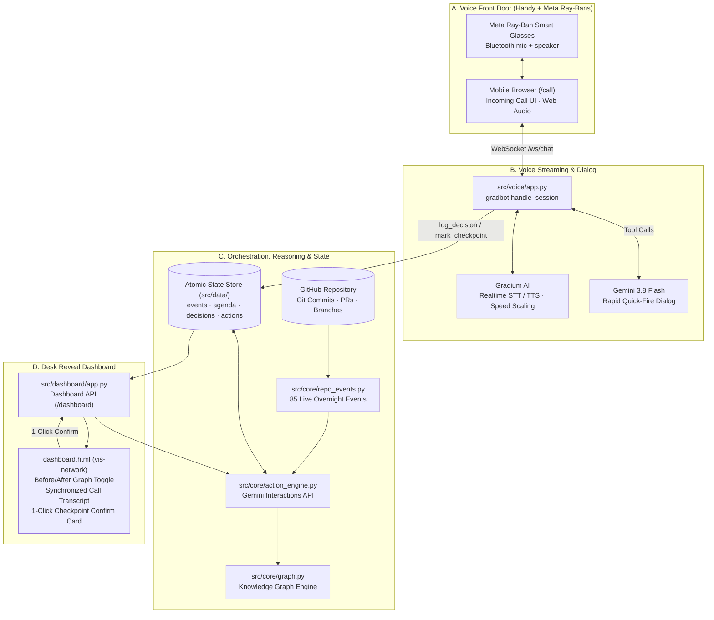

# DawnDispatch

> **Autonomous Commute Voice Dispatcher & Live Knowledge Graph**  
> *The agent prompts the human — not the other way around.*

[](https://www.python.org/downloads/)
[](https://fastapi.tiangolo.com)
[](https://deepmind.google/technologies/gemini/)
[](https://gradium.ai)
[](tests/)
[](HACKATHON.md)


---

## ⏱️ Try it on your own repo in 3 minutes

Clone, enter **your own** keys, point it at **your** repository, get called about it, watch the live screen fill up. Turn any GitHub repository or local codebase into an interactive voice standup agent.

```bash
# 1. Clone this repository
git clone https://github.com/Philipp2agent/agentic-hack-google.git
cd agentic-hack-google

# 2. Setup virtual environment, keys, and target repository
./setup.sh      # Python 3.12+ venv, asks hidden for Gradium + Gemini keys, asks for repo (path or GitHub URL), writes .env

# 3. Start call server, live visualization, and dispatch bridge
./start.sh      # call server + live screen + bridge; prints the PHONE url (HTTPS tunnel via cloudflared) and LAPTOP url
```

Then open the **PHONE** url on your phone (tap once, put the Ray-Bans or any Bluetooth headset on) and the **LAPTOP** url (`/live`) on your laptop. The agent opens with one highlight from your repo and leads a one-minute call. `./start.sh --fresh` re-reads the repo after new commits; `Ctrl-C` stops everything.

### Prerequisites
- **Python 3.12+** and **git**
- **Google Gemini API Key (`GEMINI_API_KEY`):** [Google AI Studio](https://aistudio.google.com/apikey) (dialog, context briefing, and live graph events)
- **Gradium Voice API Key (`GRADIUM_API_KEY`):** [Gradium AI](https://gradium.ai) (sub-second ultra-low latency voice streaming)
- **Target Repository:** Any local directory path or remote Git repository (or test directly with our built-in demo: `examples/sample-project`).
- **HTTPS Tunnel (Optional):** [cloudflared](https://developers.cloudflare.com/cloudflare-one/connections/connect-apps/install-and-setup/installation/) for an HTTPS url (phones require HTTPS for microphone access).

> 🔒 **Privacy & Data Security Notice:** Only your repository's high-level status material (README, last 30 commit messages, branch names, and root status files like `STAND.md`, `TODO.md`, `CHANGELOG.md`) is sent to the Google Gemini API to prepare your morning phone briefing. Source code files remain strictly local. Keys live exclusively in `.env` (git-ignored).

---

## 🌅 The Problem

Autonomous software agent swarms build code while developers sleep. Overnight, dozens of commits land, branches diverge, background pull requests open, and CI pipelines finish.

When a technical lead or founding engineer heads to the office in the morning, they face a wall of unread logs and pull request alerts. Reading raw git commit diffs on a smartphone while walking across a crowded city street is cumbersome, distracting, and unsafe. Traditional notifications fail because they demand constant eyes-down screen interaction.

## ⚡ The Solution: DawnDispatch

**DawnDispatch** turns the morning commute into an effortless, hands-free decision sprint:

1. **Voice Front Door via Meta Ray-Ban Smart Glasses (`/call`):**  
   A mobile web incoming call simulator (`/call`) rings on the user's phone. Audio streams directly over Bluetooth to open-ear Meta Ray-Ban smart glasses using Web Audio and WebSocket streaming.
2. **60-Second Rapid Quick-Fire Standup:**  
   The agent greets the lead with *"Good morning Philipp. How much time do you have?"* Upon hearing *"Got 60 seconds. Keep it fast"*, the system automatically accelerates speaking rate (Gradium TTS speed scaling) and fires concise Yes/No triage questions synthesized from overnight repository activity.
3. **Desk Reveal: Before/After Knowledge Graph (`/dashboard`):**  
   Arriving at the desk, the engineer opens the laptop dashboard. Instead of dry text, an interactive Before/After Knowledge Graph ("Show me, don't tell me") demonstrates how the 60-second voice standup resolved open blocker nodes into concrete, dispatched actions.
4. **Human Checkpoint Safeguard:**  
   Irreversible actions (such as publishing a repository, migrating production databases, or triggering production deployments) cannot execute autonomously. They pause in a `BLOCKED_ON_CHECKPOINT` state, displaying visual diff previews and awaiting a verified 1-click confirmation on the desktop dashboard.

---

## 🤝 Partner Technologies & DeepMind Alignment

### 1. Google DeepMind Gemini
* **Gemini 3.8 Flash (`gemini-3.8-flash`):** Drives conversational quickfire triage dialog with tool execution (`set_time_budget`, `log_decision`, `mark_irreversible_checkpoint`).
* **Interactions API (`google-genai`):** Synthesizes overnight repository events into a crisp 3-to-4 item agenda, infers knowledge graph relationships, and extracts post-call executive briefings.
* **Gemini Nano Banana (`gemini-3.1-flash-image` / `gemini-2.5-flash-image`):** Generated brand assets, logos, and hero visuals in `assets/`.
* **DeepMind Agentic Principles Fulfilled:**
  1. **Acts Autonomously:** Continuously aggregates repository events, plans morning agendas, and dispatches follow-up agent tasks.
  2. **Serves a Real Human:** Built for a named technical lead (Philipp) walking to his office in Zürich.
  3. **Human Retains Control:** Irreversible operations require explicit 1-click desk checkpoints.
  4. **Live Execution:** Fully tested with 85 real repository events extracted from live git history.

### 2. Gradium Voice AI
* **Low-Latency Speech-to-Text & Text-to-Speech:** Real-time bi-directional audio streaming over WebSockets powered by the `gradbot` framework.
* **Dynamic Cadence & Speed Scaling:** Accelerates speech playback from 1.0x to 1.35x when the user indicates time pressure.
* **Acoustics Optimized for Smart Glasses:** Open-ear audio tuning ensuring clear intelligibility in urban outdoor environments.

### 3. Meta Ray-Ban Smart Glasses
* Open-ear spatial speakers and beamforming directional microphones enable true eyes-up, hands-free commute triage.

---

## 🏛️ System Architecture



### Repository Structure
```
agentic-hack-google/
├── assets/                    # Brand assets, logos & hero images generated via Nano Banana
├── docs/
│   ├── ARCHITEKTUR.md         # Detailed system architecture & component interfaces
│   ├── SCHNITTSTELLE.md       # Canonical data schemas & contracts
│   ├── LIVE-EVENTS.md         # Real-time event streaming protocol
│   ├── VIDEO_SCRIPT.md        # 2-Minute video & demo walkthrough script
│   └── META.md                # Autonomous swarm development story & metrics
├── src/
│   ├── app.py                 # Unified FastAPI entry point (mounts voice & dashboard)
│   ├── core/                  # Event aggregator, Gemini client, agenda & graph engine
│   │   ├── action_engine.py   # Decision execution & irreversible checkpoint logic
│   │   ├── agenda.py          # Quick-fire triage catalog & v1->v2 roadmap
│   │   ├── gemini_client.py   # Interactions API & fallback client helper
│   │   ├── graph.py           # Knowledge graph generation (Before / After)
│   │   ├── models.py          # Pydantic v2 data models
│   │   ├── repo_events.py     # Live git log, branch & Stand aggregator
│   │   └── state.py           # RLock thread-safe atomic JSON state store
│   ├── dashboard/             # Desktop dashboard UI & API
│   │   ├── app.py             # Dashboard routes, actions & checkpoint endpoints
│   │   └── static/            # Dashboard HTML, CSS, and vis-network graph UI
│   ├── voice/                 # Mobile call simulator & Gradium voice client
│   │   ├── app.py             # Mobile call routes (/call) & transcript export
│   │   ├── gradium_client.py  # System prompt generator & decision extractor
│   │   └── static/            # Realistic iOS/Android incoming call screen
│   └── data/                  # Committed seed data & live state JSON files
├── tests/                     # 41 automated unit & integration tests (100% offline)
└── tools/
    ├── bild.py                # Nano Banana image generation tool
    ├── live_demo_events.py    # Live demo event generator for /live screen
    └── ton.py                 # Gemini audio generation tool
```

---

## 🚀 Quickstart Guide

### 1. Prerequisites
* Python 3.12 or higher for the voice call (`gradbot` wheels), 3.10+ for the core engines and tests
* Git

### 2. Installation
```bash
# Clone the repository
git clone https://github.com/Philipp2agent/agentic-hack-google.git
cd agentic-hack-google

# Create and activate a virtual environment
python3 -m venv .venv
source .venv/bin/activate

# Install required dependencies (or simply run ./setup.sh)
pip install -r requirements.txt
```

### 3. Environment Configuration
Create a `.env` file (see `.env.example`):
```bash
GEMINI_API_KEY=your_google_gemini_api_key
GRADIUM_API_KEY=your_gradium_api_key
```
*Note: The entire test suite and deterministic core engines run offline without external API keys.*

### 4. Running the Application
Launch the unified FastAPI server:
```bash
uvicorn src.app:app --host 0.0.0.0 --port 8000 --reload
```

Open the key interfaces in your browser:
* **Mobile Call Screen (Phone / Ray-Ban):** [`http://localhost:8000/call`](http://localhost:8000/call)
* **Desktop Command Dashboard (Laptop):** [`http://localhost:8000/dashboard`](http://localhost:8000/dashboard)
* **API Health Check:** [`http://localhost:8000/api/health`](http://localhost:8000/api/health)

### 5. Running the Automated Test Suite
Run all 41 test cases across contracts, core models, dashboard API, voice pipeline, and live event schemas:
```bash
python -m unittest discover -s tests -v
```
All tests run in isolated temporary environments and pass 100% offline.

---

## 🎬 2-Minute Demo Flow

1. **Mobile Incoming Call (`/call`):** Simulated incoming call rings with Web Audio chime; hands-free audio streams to Meta Ray-Bans.
2. **Rapid Quick-Fire Standup:** 60-second dialog covers 4 key overnight items:
   * **Item 1 (Status v1):** Baseline lock-in of mobile call screen and audio engine -> `APPROVE`.
   * **Item 2 (Decision v2):** Selection of Version 2 priority candidate (Option A: Real WhatsApp / Telephony) -> `APPROVE`, auto-dispatched to swarm build queue.
   * **Item 3 (Irreversible Checkpoint):** Public repository submission and autonomous write access -> `APPROVE with Checkpoint`, held in `BLOCKED_ON_CHECKPOINT`.
   * **Item 4 (Scale Network):** Expansion of commute triage network to all 42 hackathon teams -> `APPROVE`.
3. **Desk Reveal (`/dashboard`):**
   * Before/After Knowledge Graph visually transitions from unresolved red/yellow clusters to green completed nodes.
   * Amber pulsing Checkpoint Card shows git commit preview for hackathon submission.
   * Lead clicks **"1-Click Confirm Checkpoint"** -> Action turns `COMPLETED`.

See [`docs/VIDEO_SCRIPT.md`](docs/VIDEO_SCRIPT.md) for the second-by-second video recording storyboard.

---

## 🐝 The Meta Story: Built by an Autonomous Swarm

DawnDispatch was conceived, architected, and built in **2.5 hours** by an autonomous agent swarm collaborating in real-time on a Linux VPS:

* **76+ Git Commits** across parallel worktrees (`hack-chef`, `hack-bau1`, `hack-bau2`, `hack-bau3`, `hack-visual`, `Claude-Cloud`).
* **4,200+ Lines of Code** across backend inference, voice streaming, and interactive graph visualizations.
* **Zero Merge Conflicts** achieved through strict schema contracts (`docs/SCHNITTSTELLE.md`).

Read the full development narrative and swarm metrics in [`docs/META.md`](docs/META.md).

---

## 📜 License & Acknowledgments

Built at the **{Tech: Europe} Agentic AI Hackathon Zürich (10.10.2026)**.  
Sponsored by Google DeepMind and Gradium.
