# STAND agentic-hack-google

## FRAGEN AN PHILIPP
- 1. Agenten hack-bau2 (Voice/Call) und hack-bau3 (Dashboard/Graph) anlegen, damit wir 4 Spuren parallel bauen? (Option A: Ja, bitte Karten bereitstellen / Option B: hack-bau1 baut alles sequenziell) -> Empfehlung: 1A

## CLAUDE-LINKS ZUM KLICKEN
- [claude-02: Architektur & Bau-Pakete](https://claude.ai/code?repositories=Philipp2agent/agentic-hack-google&prompt=Bearbeite%20auftraege/claude-02.md%20und%20liefere%20das%20Ergebnis%20als%20Branch%20mit%20Pull%20Request)

| ID | Auftrag | Wer | Branch | Status | Naechster Schritt |
|---|---|---|---|---|---|
| Schritt-0 | Datenmodelle & docs/SCHNITTSTELLE.md | hack-chef | main | fertig, gemerged | - |
| IDEE | Schaerfung: Phone Call UI, Quick Fire, Before/After Graph | hack-chef | main | fertig, gemerged | - |
| P-CORE | src/core: Aggregator, Agenda-Synthese & Graph Engine | hack-bau1 | agent/hack-bau1 | fertig gebaut & getestet | PR & Merge nach main |
| P-VOICE | src/voice: Mobile Call Screen (/call) & Gradium Web Audio | hack-bau2 | agent/hack-bau2 | wartet auf Anlegen | Philipp legt hack-bau2 an |
| P-DASHBOARD | src/dashboard: Vorher-Nachher Graph (/dashboard) & Checkpoints | hack-bau3 | agent/hack-bau3 | wartet auf Anlegen | Philipp legt hack-bau3 an |
| P-VISUAL | assets/brand: Graph Icons, Call Avatar, Banner (Nano Banana) | hack-visual | agent/hack-visual | vergeben, laeuft | Bildgenerierung |
| claude-02 | docs/ARCHITEKTUR.md & gemini-Pakete | Claude-Cloud | claude/... | laeuft in Cloud | Merge nach PR |

## ZEITPLAN

```mermaid
gantt
  title Hackathon-Zeitplan (Zuerich, CEST, Abgabe 19:00)
  dateFormat HH:mm
  axisFormat %H:%M
  section Phasen
  Phase 1 Rahmen & Setup         :done, p1, 14:00, 15:00
  Phase 2 Idee DawnDispatch      :done, p2, 15:00, 16:15
  Phase 3 Paralleler Bau         :crit, active, p3, 16:15, 18:00
  Phase 4 Feature-Freeze & Video :p4, 18:00, 18:40
  Phase 5 Politur & Abgabe       :p5, 18:40, 19:00
  section Parallele Spuren
  P-CORE Knowledge Graph Inferenz   :crit, active, p_core, 16:15, 17:45
  P-VOICE Mobile Call & Gradium     :crit, p_voi, 16:20, 17:45
  P-DASHBOARD Vorher-Nachher UI     :crit, p_dash, 16:20, 17:45
  P-VISUAL Graph Icons & Banner     :active, p_vis, 16:15, 17:15
```

