# STAND agentic-hack-google

## FRAGEN AN PHILIPP
- Nächster Schritt: Hackathon-Rahmen (HACKATHON.md) oder Projekt-Idee (IDEE.md)

## CLAUDE-LINKS ZUM KLICKEN
- keine

| ID | Auftrag | Wer | Branch | Status | Naechster Schritt |
|---|---|---|---|---|---|
| T-01 | docs/STRUKTUR.md Ordnerstruktur | hack-bau1 | agent/hack-bau1 | fertig, gemerged | - |
| T-02 | Titelbild-Entwurf assets/titelbild.jpg | hack-visual | agent/hack-visual | fertig, gemerged | - |
| T-03 | Titelbild v2 & Token-/Kostenbericht | hack-visual | agent/hack-visual | vergeben | Bild generieren & Tokens/Kosten nennen |
| claude-01 | tools/ton.py (Gemini TTS) | Claude-Cloud | claude/... | fertig, gemerged | - |

## ZEITPLAN

```mermaid
gantt
  title Hackathon-Zeitplan (Platzhalter, wird aus HACKATHON.md gefuellt)
  dateFormat HH:mm
  axisFormat %H:%M
  section Phasen
  Plan            :p1, 00:00, 45m
  Bau             :p2, after p1, 225m
  Freeze, Politur :p3, after p2, 60m
  Abgabe          :p4, after p3, 30m
```

