# STAND agentic-hack-google

## FRAGEN AN PHILIPP
(keine offenen Fragen - Spuren sind klar verteilt)

## CLAUDE-LINKS ZUM KLICKEN
- [claude-03: MVP Ende-zu-Ende Python-Backend (voice, dashboard, main) & tools/video](https://claude.ai/code?repositories=Philipp2agent/agentic-hack-google&prompt=Bearbeite%20auftraege/claude-03.md%20und%20liefere%20das%20Ergebnis%20als%20Branch%20mit%20Pull%20Request)

| ID | Auftrag | Wer | Branch | Status | Naechster Schritt |
|---|---|---|---|---|---|
| Schritt-0 | Datenmodelle & docs/SCHNITTSTELLE.md | hack-chef | main | fertig, gemerged | - |
| IDEE | Schaerfung: Phone Call UI, Quick Fire, Before/After Graph | hack-chef | main | fertig, gemerged | - |
| claude-02 | docs/ARCHITEKTUR.md, state.py & Bau-Pakete | Claude-Cloud | claude/... | fertig, gemerged | - |
| claude-03 | MVP Ende-zu-Ende Python-Backend (voice, dashboard, main) & tools/video | Claude-Cloud | claude/... | laeuft in Cloud | Link klicken, PR abwarten |
| P-DATA | Demo-Szenario & Graph-Daten in src/data | hack-bau1 | agent/hack-bau1 | beauftragt | Umsetzung auf Branch agent/hack-bau1 |
| P-VOICE-UI | Anruf-Oberflaeche in src/voice/static | hack-bau2 | agent/hack-bau2 | beauftragt | Umsetzung auf Branch agent/hack-bau2 |
| P-DASHBOARD-UI | Graph-Ansicht in src/dashboard/static | hack-bau3 | agent/hack-bau3 | beauftragt | Umsetzung auf Branch agent/hack-bau3 |
| P-VISUAL | Avatar, Knoten-Icons, Banner, Titelkarten | hack-visual | agent/hack-visual | beauftragt | Assets generieren in assets/ |
| P-MARKETING | 2-Minuten-Video-Skript & README-Erzaehlung | hack-marketing | agent/hack-marketing | beauftragt | Skript & Text schreiben |
| P-REVIEW | Testplan & Ende-zu-Ende-Test um 17:15 | hack-review | agent/hack-review | vorbereitet | Testplan erstellen |

## ZEITPLAN

```mermaid
gantt
  title Hackathon-Zeitplan (Zuerich, CEST, Abgabe 19:00)
  dateFormat HH:mm
  axisFormat %H:%M
  section Phasen
  Phase 1 Rahmen & Setup         :done, p1, 14:00, 15:00
  Phase 2 Idee DawnDispatch      :done, p2, 15:00, 16:15
  Phase 3 Paralleler Bau         :crit, active, p3, 16:15, 18:00
  Phase 4 Feature-Freeze & Video :p4, 18:00, 18:40
  Phase 5 Politur & Abgabe       :p5, 18:40, 19:00
  section Parallele Spuren
  claude-02 Architektur & State   :done, c2, 16:15, 16:35
  claude-03 Backend MVP & Video   :crit, active, c3, 16:35, 17:15
  P-DATA Demo-Daten (hack-bau1)   :active, p_dat, 16:35, 17:15
  P-VOICE-UI Call Screen (hack-bau2) :active, p_vui, 16:35, 17:15
  P-DASH-UI Graph UI (hack-bau3)  :active, p_dui, 16:35, 17:15
  P-VISUAL Icons & Banner         :active, p_vis, 16:35, 17:15
  P-REVIEW E2E-Test               :p_rev, 17:15, 17:45
```

