# STAND agentic-hack-google

## FRAGEN AN PHILIPP
- 1. Modell-Konfiguration fuer hack-visual, hack-marketing & hack-review in Buzz: Alle 3 Agenten melden 'the configured model wasn't found at the provider's endpoint'. Bitte in Buzz Desktop unter Agent-Settings fuer hack-visual, hack-marketing und hack-review ein aktives Modell waehlen und neu starten. -> Empfehlung: 1A

## CLAUDE-LINKS ZUM KLICKEN
- [claude-03: Lauffaehiges MVP E2E Backend, Integration & Video-Tools](https://claude.ai/code?repositories=Philipp2agent/agentic-hack-google&prompt=Bearbeite%20auftraege/claude-03.md%20und%20liefere%20das%20Ergebnis%20als%20Branch%20mit%20Pull%20Request)

| ID | Auftrag | Wer | Branch | Status | Naechster Schritt |
|---|---|---|---|---|---|
| Schritt-0 | Datenmodelle & docs/SCHNITTSTELLE.md | hack-chef | main | fertig, gemerged | - |
| IDEE | Schaerfung: Phone Call UI, Quick Fire, Before/After Graph | hack-chef | main | fertig, gemerged | - |
| claude-02 | docs/ARCHITEKTUR.md, state.py & Baupakete | Claude-Cloud | main | fertig, gemerged | - |
| P-CORE | src/core: Aggregator, Agenda-Synthese & Graph Engine | hack-bau1 | agent/hack-bau1 | fertig, gemerged | - |
| P-VOICE | src/voice: Mobile Call Screen (/call) & Gradium Web Audio | hack-bau2 / hack-bau1 | main | fertig, gemerged | E2E Integration in claude-03 |
| P-DASHBOARD | src/dashboard: Vorher-Nachher Graph (/dashboard) & Checkpoints | hack-bau3 | main | fertig, gemerged | E2E Integration in claude-03 |
| gemini-01 | Demo-Szenario, Live Repo Events & State-Integration | hack-bau1 | agent/hack-bau1 | vergeben, laeuft | auftraege/gemini-01.md umsetzen |
| claude-03 | Lauffaehiges MVP E2E Backend & Video-Tools | Claude-Cloud | claude/... | vergeben | Klick durch Philipp |
| P-VISUAL | assets/brand: Graph Icons, Call Avatar, Banner (Nano Banana) | hack-visual | agent/hack-visual | blockiert (Modellfehler in Buzz) | Modell in Agent-Settings anpassen |
| P-MARKETING | 2-Minuten-Video-Skript & README-Erzaehlung | hack-marketing | agent/hack-marketing | blockiert (Modellfehler in Buzz) | Modell in Agent-Settings anpassen |
| P-REVIEW | Testplan & Vorbereitung fuer E2E-Test 17:15 | hack-review | agent/hack-review | blockiert (Modellfehler in Buzz) | Modell in Agent-Settings anpassen |

## ZEITPLAN

```mermaid
gantt
  title Hackathon-Zeitplan (Zuerich, CEST, Abgabe 19:00)
  dateFormat HH:mm
  axisFormat %H:%M
  section Phasen
  Phase 1 Rahmen & Setup         :done, p1, 14:00, 15:00
  Phase 2 Idee DawnDispatch      :done, p2, 15:00, 16:15
  Phase 3 Paralleler Bau         :crit, active, p3, 16:15, 18:00
  Phase 4 Feature-Freeze & Video :p4, 18:00, 18:40
  Phase 5 Politur & Abgabe       :p5, 18:40, 19:00
  section Parallele Spuren
  P-CORE Knowledge Graph Inferenz   :done, p_core, 16:15, 16:20
  P-VOICE Mobile Call & Gradium     :done, p_voi, 16:20, 16:32
  P-DASHBOARD Vorher-Nachher UI     :done, p_dash, 16:20, 16:30
  gemini-01 Live Events & State     :crit, active, p_gem1, 16:35, 17:30
  claude-03 E2E Integration & Video :crit, active, p_cl3, 16:35, 17:15
  P-VISUAL Graph Icons & Banner     :active, p_vis, 16:15, 17:15
```

