# STAND agentic-hack-google

## FRAGEN AN PHILIPP
- Keine offenen Blocker-Fragen. Neue Aufteilung bis 18:00 aktiv.

## CLAUDE-LINKS ZUM KLICKEN
- [claude-03: Lauffaehiges MVP E2E Backend, Voice & Integration](https://claude.ai/code?repositories=Philipp2agent/agentic-hack-google&prompt=Bearbeite%20auftraege/claude-03.md%20und%20liefere%20das%20Ergebnis%20als%20Branch%20mit%20Pull%20Request)
- [claude-04: Live Mission Control Visualisierung in src/live](https://claude.ai/code?repositories=Philipp2agent/agentic-hack-google&prompt=Bearbeite%20auftraege/claude-04.md%20und%20liefere%20das%20Ergebnis%20als%20Branch%20mit%20Pull%20Request)

| ID | Auftrag | Wer | Branch | Status | Naechster Schritt |
|---|---|---|---|---|---|
| claude-03 | Anruf, Backend & Integration (src/voice, src/app) | Claude-Cloud | claude/... | laeuft in Cloud | Warten auf PR |
| claude-04 | Live-Visualisierung (src/live Mission Control) | Claude-Cloud | claude/... | bereit / Link offen | Start via Claude-Link |
| P-DATA-AGENDA | Demo-Agenda Daten (Stand v1, v2-Optionen, Teilnehmer-Netz) | hack-bau1 | agent/hack-bau1 | vergeben, laeuft | src/data/*.json an docs/LIVE-EVENTS.md anpassen (bau2/bau3 unterstuetzen) |
| P-SUPPORT-TEST | Unterstuetzung bau1 & Vorbereitung Tests | hack-bau2, hack-bau3 | agent/hack-bau2, agent/hack-bau3 | vergeben, laeuft | Daten mitbau1 abstimmen; keine Aenderungen in src/voice, src/live, src/app |
| P-VISUAL | Avatar (/call) & Wissensgraph-/Knoten-Icons | hack-visual | agent/hack-visual | vergeben, laeuft | Assets nach assets/brand/ und assets/icons/ ablegen |
| P-MARKETING | Drehplan 2 Kameras (Vlog-Kamera & Brille) nach LIVE-EVENTS | hack-marketing | agent/hack-marketing | vergeben, laeuft | docs/DREHPLAN.md erstellen |
| P-REVIEW | E2E-Pruefung & Systemtest (ab 17:15) | hack-review | agent/hack-review | wartet (ab 17:15) | Startet sobald claude-03/04 und Daten bereitstehen |

## ZEITPLAN

```mermaid
gantt
  title Hackathon-Zeitplan (Zuerich, CEST, Abgabe 19:00)
  dateFormat HH:mm
  axisFormat %H:%M
  section Phasen
  Phase 1 Setup & Architektur    :done, p1, 14:00, 15:00
  Phase 2 Idee & Spezifikation   :done, p2, 15:00, 16:15
  Phase 3 Paralleler Bau         :crit, active, p3, 16:15, 18:00
  Phase 4 Feature-Freeze & Video :p4, 18:00, 18:30
  Phase 5 Politur & Abgabe       :p5, 18:30, 19:00
  section Sprint bis 18:00
  claude-03 Anruf & Integration  :crit, active, p_cl3, 16:35, 17:15
  claude-04 Live Visualisierung  :crit, active, p_cl4, 16:50, 17:30
  hack-bau1 Demo-Agenda Daten    :active, p_ag, 16:50, 17:20
  hack-visual Avatar & Icons     :active, p_vis, 16:45, 17:15
  hack-marketing Drehplan 2-Cam  :active, p_mkt, 16:50, 17:20
  hack-review Testlauf           :p_rev, 17:15, 17:45
```

