# STAND agentic-hack-google

## FRAGEN AN PHILIPP
- Keine offenen Blocker-Fragen. claude-03 laeuft, Bauer-Sprint bis 17:15 ist aktiv.

## CLAUDE-LINKS ZUM KLICKEN
- [claude-03: Lauffaehiges MVP E2E Backend, Integration PR 2 & Video-Tools (laeuft in Cloud)](https://claude.ai/code?repositories=Philipp2agent/agentic-hack-google&prompt=Bearbeite%20auftraege/claude-03.md%20und%20liefere%20das%20Ergebnis%20als%20Branch%20mit%20Pull%20Request)

| ID | Auftrag | Wer | Branch | Status | Naechster Schritt |
|---|---|---|---|---|---|
| Schritt-0 | Datenmodelle & docs/SCHNITTSTELLE.md | hack-chef | main | fertig, gemerged | - |
| IDEE | Schaerfung: Phone Call UI, Quick Fire, Before/After Graph | hack-chef | main | fertig, gemerged | - |
| claude-02 | docs/ARCHITEKTUR.md, state.py & Baupakete | Claude-Cloud | main | fertig, gemerged | In claude-03 integriert |
| P-CORE | src/core: Aggregator, Agenda-Synthese & Graph Engine | hack-bau1 | main | fertig, gemerged | - |
| P-DASHBOARD | src/dashboard: Vorher-Nachher Graph & Checkpoints | hack-bau3 | main | fertig, gemerged | - |
| claude-03 | E2E Integration (Backend, Voice, Dashboard, PR 2) | Claude-Cloud | claude/... | laeuft in Cloud | Warten auf PR bis 17:15 |
| P-VOICE-STAT | Anruf-Oberflaeche rein statisch, poliert fuer Demo | hack-bau2 | agent/hack-bau2 | vergeben, laeuft | Statischen Call-Flow vollenden |
| P-AGENDA-V2 | Agenda-Inhalt v1 -> v2 aus context/hackathon-day | hack-bau1 | agent/hack-bau1 | vergeben, laeuft | src/data/agenda.json aktualisieren |
| P-GRAPH-POLISH | Graph-Feinschliff Vorher/Nachher & Checkpoints | hack-bau3 | agent/hack-bau3 | vergeben, laeuft | Dashboard Visuals schaerfen |
| P-VISUAL | Avatar (/call) & Wissensgraph-Icons | hack-visual | agent/hack-visual | vergeben, laeuft | Assets nach assets/ brand/ ablegen |
| P-MARKETING | 2-Minuten Video-Skript (v1 zu v2 Story) | hack-marketing | agent/hack-marketing | vergeben, laeuft | docs/VIDEO_SKRIPT.md schreiben |
| P-REVIEW | Bereitstellung & E2E-Pruefung | hack-review | agent/hack-review | wartet | Startet bei Eintreffen claude-03 |

## ZEITPLAN

```mermaid
gantt
  title Hackathon-Zeitplan (Zuerich, CEST, Abgabe 19:00)
  dateFormat HH:mm
  axisFormat %H:%M
  section Phasen
  Phase 1 Setup & Architektur    :done, p1, 14:00, 15:00
  Phase 2 Idee & Spezifikation   :done, p2, 15:00, 16:15
  Phase 3 Paralleler Bau         :crit, active, p3, 16:15, 17:30
  Phase 4 Feature-Freeze & Video :p4, 17:30, 18:30
  Phase 5 Politur & Abgabe       :p5, 18:30, 19:00
  section Sprint bis 17:15
  claude-03 Integration & Voice  :crit, active, p_cl3, 16:35, 17:15
  P-VOICE-STAT Statische Call UI :active, p_voi, 16:45, 17:15
  P-AGENDA-V2 Agenda v1 zu v2    :active, p_ag, 16:45, 17:15
  P-GRAPH-POLISH Graph Feinschliff :active, p_gr, 16:45, 17:15
  P-VISUAL Avatar & Icons        :active, p_vis, 16:45, 17:15
  P-MARKETING Video-Skript       :active, p_mkt, 16:45, 17:15
  P-REVIEW E2E Pruefung          :p_rev, 17:15, 17:30
```

