# STAND agentic-hack-google

## FRAGEN AN PHILIPP
- Keine offenen Fragen oder Blocker.

## CLAUDE-LINKS ZUM KLICKEN
- [claude-02: Architektur & 4 Bau-Pakete](https://claude.ai/code?repositories=Philipp2agent/agentic-hack-google&prompt=Bearbeite%20auftraege/claude-02.md%20und%20liefere%20das%20Ergebnis%20als%20Branch%20mit%20Pull%20Request)

| ID | Auftrag | Wer | Branch | Status | Naechster Schritt |
|---|---|---|---|---|---|
| T-01 | docs/STRUKTUR.md Ordnerstruktur | hack-bau1 | agent/hack-bau1 | fertig, gemerged | - |
| T-02 | Titelbild-Entwurf assets/titelbild.jpg | hack-visual | agent/hack-visual | fertig, gemerged | - |
| T-03 | Titelbild v2 & Token-/Kostenbericht | hack-visual | agent/hack-visual | fertig, gemerged | - |
| T-04 | Titelbild v3 (Solitäre Silhouette, Bienen-Schwarm-Agents, Basstöne) | hack-visual | agent/hack-visual | fertig, gemerged | - |
| claude-01 | tools/ton.py (Gemini TTS) | Claude-Cloud | claude/... | fertig, gemerged | - |
| IDEE | IDEE.md DawnDispatch (Web Voice + Dashboard) | hack-chef | main | fertig, gemerged | - |
| claude-02 | docs/ARCHITEKTUR.md & gemini-01..04 Pakete | Claude-Cloud | claude/... | offen, wartet auf Start | Philipp klickt Claude-Link |
| gemini-01 | Data Models & Action Engine | hack-bau1 | agent/hack-bau1 | wartet auf claude-02 | Start 16:15 |
| gemini-02 | Voice Pipeline & gradbot Web Audio | hack-bau2 | agent/hack-bau2 | wartet auf claude-02 | Start 16:15 |
| gemini-03 | Web Dashboard ("Show me, don't tell me") | hack-bau3 | agent/hack-bau3 | wartet auf claude-02 | Start 16:15 |
| gemini-04 | Visual Identity & Hero Banners | hack-visual | agent/hack-visual | wartet auf claude-02 | Start 16:15 |

## ZEITPLAN

```mermaid
gantt
  title Hackathon-Zeitplan (Zuerich, CEST, Abgabe 19:00)
  dateFormat HH:mm
  axisFormat %H:%M
  section Phasen
  Phase 1 Rahmen & Setup         :done, p1, 14:00, 15:00
  Phase 2 Idee & DawnDispatch    :done, p2, 15:00, 15:55
  Phase 3 Bau & Integration      :crit, p3, 16:15, 18:00
  Phase 4 Feature-Freeze & Video :p4, 18:00, 18:40
  Phase 5 Politur & Abgabe       :p5, 18:40, 19:00
  section Auftraege
  IDEE.md Konzept DawnDispatch   :done, t_idee, 15:30, 15:55
  claude-02 Architektur          :active, t_cl2, 15:55, 16:15
  gemini-01..04 Paralleler Bau   :crit, t_gem, 16:15, 18:00
```

