# STAND agentic-hack-google

## FRAGEN AN PHILIPP
- hack-bau2 und hack-bau3 anlegen oder Pakete voice/dashboard an hack-bau1 bzw. hack-chef uebergeben?

## CLAUDE-LINKS ZUM KLICKEN
- [claude-02: Architektur & 4 Bau-Pakete](https://claude.ai/code?repositories=Philipp2agent/agentic-hack-google&prompt=Bearbeite%20auftraege/claude-02.md%20und%20liefere%20das%20Ergebnis%20als%20Branch%20mit%20Pull%20Request)

| ID | Auftrag | Wer | Branch | Status | Naechster Schritt |
|---|---|---|---|---|---|
| Schritt-0 | Datenmodelle (JSONs) & docs/SCHNITTSTELLE.md | hack-chef | main | fertig, gemerged | - |
| P-CORE | src/core: Aggregator & Agenda-Synthese | hack-bau1 | agent/hack-bau1 | vergeben, laeuft | Bau & PR |
| P-VISUAL | assets/brand: Logo & Banner (Nano Banana) | hack-visual | agent/hack-visual | vergeben, laeuft | Bildgenerierung |
| P-VOICE | src/voice: gradbot Voice Call (Port 8090) | offen (hack-bau3) | agent/hack-bau3 | wartet auf Zuteilung | Klaerung mit Philipp |
| P-DASHBOARD | src/dashboard: Action Cards & Checkpoint | offen (hack-bau2) | agent/hack-bau2 | wartet auf Zuteilung | Klaerung mit Philipp |
| T-01 | docs/STRUKTUR.md Ordnerstruktur | hack-bau1 | agent/hack-bau1 | fertig, gemerged | - |
| T-02 | Titelbild-Entwurf assets/titelbild.jpg | hack-visual | agent/hack-visual | fertig, gemerged | - |
| T-03 | Titelbild v2 & Token-/Kostenbericht | hack-visual | agent/hack-visual | fertig, gemerged | - |
| T-04 | Titelbild v3 (Solitäre Silhouette, Bienen-Schwarm-Agents) | hack-visual | agent/hack-visual | fertig, gemerged | - |
| claude-01 | tools/ton.py (Gemini TTS) | Claude-Cloud | claude/... | fertig, gemerged | - |
| IDEE | IDEE.md DawnDispatch (Web Voice + Dashboard) | hack-chef | main | fertig, gemerged | - |
| claude-02 | docs/ARCHITEKTUR.md & gemini-01..04 Pakete | Claude-Cloud | claude/... | laeuft in Cloud | Merge nach PR |

## ZEITPLAN

```mermaid
gantt
  title Hackathon-Zeitplan (Zuerich, CEST, Abgabe 19:00)
  dateFormat HH:mm
  axisFormat %H:%M
  section Phasen
  Phase 1 Rahmen & Setup         :done, p1, 14:00, 15:00
  Phase 2 Idee & DawnDispatch    :done, p2, 15:00, 15:55
  Phase 3 Bau & Integration      :crit, active, p3, 16:05, 18:00
  Phase 4 Feature-Freeze & Video :p4, 18:00, 18:40
  Phase 5 Politur & Abgabe       :p5, 18:40, 19:00
  section Auftraege
  Schritt 0 Datenmodelle & Schnittstelle :done, s0, 16:05, 16:15
  P-CORE Aggregator & Agenda    :crit, active, p_core, 16:15, 17:30
  P-VISUAL Branding & Banner    :active, p_vis, 16:15, 17:00
  P-VOICE gradbot Web Audio     :crit, p_voi, 16:15, 17:45
  P-DASHBOARD UI & Checkpoints  :crit, p_dash, 16:15, 17:45
```

