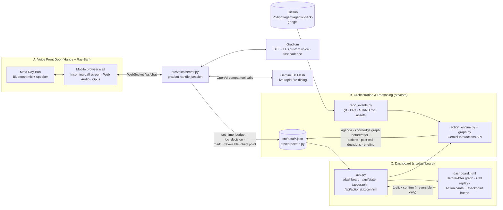

# DawnDispatch – Systemarchitektur (Auftrag claude-02)

Stand 10.10.2026, 16:35 CEST. Verbindlich fuer die Bau-Pakete `auftraege/gemini-01.md` bis `gemini-04.md` (Baufenster bis 17:45, Feature-Freeze 18:00, Abgabe 19:00).
Baut auf hack-chefs Schritt 0 auf (`docs/SCHNITTSTELLE.md`, Seeds in `src/data/*.json`) und auf der geschaerften `IDEE.md` (Incoming-Call-Screen, "How much time do you have?", Rapid-Fire, Vorher/Nachher-Knowledge-Graph). Bei Widerspruch gilt: `src/core/models.py` > diese Datei > SCHNITTSTELLE.md.
Sprache: Doku Deutsch; Code, Prompts, UI und Commit-Texte Englisch.

## 0. Leitplanken (nicht verhandelbar)
- **Kein Twilio, kein WhatsApp.** Der "Anruf" ist die mobile Web-Seite `/call` (simulierter Incoming-Call-Screen) mit Web Audio + WebSocket; Audio laeuft per Bluetooth ueber die Meta-Ray-Ban-Brille. Mikrofon im Browser braucht HTTPS → cloudflared-Tunnel am VPS.
- **Fundament:** gradbot-Demo `simple_chat` (`/home/buzzagent/hack/vendor/gradbot/demos/simple_chat`): FastAPI + `gradbot.websocket.handle_session` + Gradium STT/TTS. Muster kopieren, nicht Dateien.
- **Stack:** Gemini 3.8 Flash (a) ueber OpenAI-kompatiblen Endpunkt in der gradbot-Sprachschleife (`LLM_BASE_URL`/`LLM_MODEL`), (b) ueber `google-genai` Interactions API fuer Agenda-Synthese, Knowledge-Graph-Inferenz und Post-Call-Extraktion. Gradium STT/TTS + Voice Design ueber gradbot. FastAPI + HTML/Tailwind (CDN) + Vanilla JS + vis-network (CDN) fuer den Graph.
- **Ein Prozess:** `uvicorn src.app:app` serviert `/call`, `/dashboard` und alle APIs. Zustand = JSON-Dateien in `src/data/` hinter `src/core/state.py` (niemand schreibt die Dateien direkt).
- **Human Checkpoint:** Unumkehrbares (`AgendaItem.is_irreversible`) wird per Stimme nur *beschlossen*; Ausfuehrung erst nach Klick im Laptop-Dashboard.
- **Keine Schluessel im Repo.** Nur `.env.example`; am VPS `set -a; . /home/buzzagent/hack/secrets.env; set +a`.

## 1. Systemuebersicht



ASCII-Variante:
```
 Ray-Ban ⇄ Handy /call (Incoming Call → Accept) ══ WS /ws/chat ══ src/voice/server.py ⇄ Gradium STT/TTS
                                                                  │ tools: set_time_budget · log_decision · mark_irreversible_checkpoint
                                                                  ▼
 GitHub repo ─► src/core/repo_events.py ─► src/core/action_engine.py + graph.py (Gemini 3.8 Flash, Interactions API)
                                                                  │ agenda · graph before/after · actions · post-call · briefing
                                                                  ▼
                                   src/data/{overnight_events,agenda,decisions,actions,call,meta}.json  (src/core/state.py)
                                                                  │ GET /api/state · GET /api/graph?phase=before|after
                                                                  ▼
 Laptop /dashboard ◄── src/dashboard/app.py ──► POST /api/actions/{id}/confirm ──► action_engine.execute_action()
```

**Demo-Ablauf (IDEE.md Skript → Komponenten):**
1. *Vorbereitung (hack-chef):* `python -m src.core.action_engine --seed` → Events sammeln, Agenda (max. 3, genau 1 unumkehrbar) + Graph "before" via Gemini, `python -m src.core.state --reset`.
2. *0:00 Incoming Call:* Handy oeffnet `/call`; Screen "Incoming call: DawnDispatch" + Klingelton (WebAudio-Chime); Tap "Accept" → WS `start` → Agent spricht zuerst: *"Morning Philipp. Swarm overnight triage ready. How much time do you have?"* → Antwort → Tool `set_time_budget(60)`.
3. *0:20 Rapid-Fire:* Agent stellt Ja/Nein-Fragen in schneller Kadenz (ein Item pro Turn); jede Antwort → `log_decision` → `state.add_decision` → `action_engine.on_decision` (Reversibles sofort, Unumkehrbares `BLOCKED_ON_CHECKPOINT` + `mark_irreversible_checkpoint`). Schluss: *"Captured. Knowledge graph updated. See you at your desk."* + Auflege-Ton.
4. *0:50 Laptop:* `/dashboard` zeigt Toggle **Before / After**: Graph "before" (offene Knoten gelb/rot) vs. "after" (entschiedene Knoten gruen, Aktionen verknuepft), Call-Replay mit synchronem Transkript, Action Cards, Checkpoint-Button; Klick → `confirm_checkpoint` → `execute_action` → Artefakte. Briefing (3 Bullets) aus `process_post_call`.

## 2. Datenmodelle & Dateien (eingefroren)

Quelle der Wahrheit: **`src/core/models.py`** (Pydantic v2). Formalisiert `docs/SCHNITTSTELLE.md` 1:1 und ergaenzt nur optionale Felder; die Seeds in `src/data/*.json` validieren unveraendert (`tests/test_contract.py`). Regel: ergaenzen ja, umbenennen/loeschen nein; nur hack-bau1 editiert `models.py`/`state.py`.

| Modell | Datei | Pflichtfelder | Optionale Felder (Default) | Vokabular |
|---|---|---|---|---|
| `OvernightEvent` | `overnight_events.json` (Liste) | `id` (evt-001), `source` (Freitext: "git commit 3cdd23d", "PR #4"), `agent_id`, `title` | `details`, `severity`=INFO, `proposed_action`, `timestamp`, `ref` | `severity`: INFO, WARNING, ERROR |
| `AgendaItem` | `agenda.json` (Liste) | `item_id` (agenda-01), `topic`, `question_for_lead`, `recommended_action` | `is_irreversible`=false, `action_type`=NOTE, `event_ids`, `priority`=1 | `action_type` s. u.; `is_irreversible` entscheidet den Checkpoint |
| `DecisionRecord` | `decisions.json` (Liste) | `item_id`, `decision_type` | `voice_notes`, `timestamp`(auto), `human_verified`=false, `decision_id`(auto), `source`=voice_tool | APPROVE, REJECT, HOLD, AMEND · source: voice_tool, post_call, dashboard |
| `ActionExecution` | `actions.json` (Liste) | `item_id`, `action_type` | `action_id`(auto), `status`=PENDING, `artifacts`={} , `description`, `checkpoint_reason`, `created_at`, `updated_at` | `status`: PENDING, EXECUTING, COMPLETED, BLOCKED_ON_CHECKPOINT, FAILED |
| `CallRecord` | `call.json` (Objekt, git-ignoriert) | – | `status`=idle, `started_at`, `ended_at`, `language`=en, `voice_id`, `time_budget_s`, `transcript[]` (`TranscriptTurn`: `role` agent/user/tool, `text`, `t_s`, `turn_idx`), `audio_url`, `briefing[]` | `status`: idle, ringing, live, ended |
| `meta` | `meta.json` (Objekt, git-ignoriert) | – | freie Schluessel: `agenda_interaction_id`, `budget:<key>`, `checkpoint_reason:<item_id>` | |
| `KnowledgeGraph` | abgeleitet (API, optional `knowledge_graph_before.json`/`_after.json`) | `phase` | `nodes[]` (`GraphNode`: `id`, `label`, `kind`, `status`, `data`), `edges[]` (`source`, `target`, `label`) | `kind`: agent, event, agenda, decision, action, checkpoint · `status`: open, blocked, resolved, info |

- `artifacts` ist ein freies JSON-Objekt (wie in den Seeds). Empfohlene Schluessel (`models.ARTIFACT_KEYS`): `diff`, `log`/`logs`, `commit`, `url`, `file`, `note`, `reason`, `pending_url`, `port`. Das Dashboard rendert `diff`/`log` in `<pre>`, `url` als Link, Rest als Key/Value.
- `action_type`-Vokabular (`models.ACTION_TYPES`, Empfehlung; Seeds nutzen eigene Namen): reversibel `MERGE_BRANCH`, `DISPATCH_AGENT`, `RUN_TESTS`, `UPDATE_BUDGET`, `NOTE`; unumkehrbar `DELETE_FILES`, `TAG_RELEASE`, `PUBLISH_ASSET`, `DEPLOY`.
- Zeitstempel ISO 8601 UTC (`models.now_iso()`); IDs `evt-NNN`, `agenda-NN`, `dec-<8hex>`, `act-<8hex>` (Seeds: `act-101`).
- **Graph-Ableitung (deterministisch, `src/core/graph.py::build_graph(state, phase)`):** Knoten = Agenten (`agent_id`), Events, Agenda-Items, (after:) Decisions, Actions, Checkpoints. Kanten: agent→event, event→agenda (`event_ids`, sonst per `agent_id`-Match), agenda→decision, decision→action. Status: before: agenda `open` (ERROR-Events → `data.severity` fuer rot/gelb), after: Item mit Decision `resolved`, Action `BLOCKED_ON_CHECKPOINT` → Knoten `blocked`, `COMPLETED` → `resolved`, `FAILED` → `open`.

**State-Store `src/core/state.py`:** `load()`, `save()`, `reset()` (loescht decisions/actions/call/meta, behaelt events/agenda), `update(fn)`, `set_inputs(events, agenda)`, `add_decision()`, `latest_decision()`, `add_action()`, `set_action_status()`, `confirm_checkpoint()`, `set_meta()`, `start_call()`, `set_time_budget()`, `append_turn()`, `end_call()`. RLock + atomares Schreiben. CLI `python -m src.core.state --reset|--show|--json`. **Tests setzen `DAWN_DATA_DIR` auf ein Temp-Verzeichnis** (Muster `tests/test_contract.py`), sonst veraendern sie die committeten Seeds; vor dem Commit `git status src/data/` pruefen.

**Integrationsnaehte** – Funktionen, die hack-bau1 in `src/core/action_engine.py` und `src/core/graph.py` bereitstellt; bau2/bau3 rufen sie per `try: import` auf und laufen vor dem Merge ohne sie weiter:
```python
# src/core/action_engine.py
def synthesize_agenda(events: list[OvernightEvent], refresh: bool = False) -> list[AgendaItem]: ...
def on_decision(record: DecisionRecord) -> list[ActionExecution]:
    """plan + execute reversible actions now; create BLOCKED_ON_CHECKPOINT for irreversible items"""
def execute_action(action_id: str) -> ActionExecution:
    """EXECUTING -> COMPLETED|FAILED, fills artifacts (diff, commit, log, file)"""
def process_post_call() -> CallRecord:
    """decisions missing from the transcript (source=post_call), 3-bullet briefing; idempotent"""
# src/core/graph.py
def build_graph(state: DawnState, phase: GraphPhase) -> KnowledgeGraph: ...
```
```python
try:
    from src.core import action_engine
except ImportError:          # gemini-01 not merged yet
    action_engine = None
if action_engine: await asyncio.to_thread(action_engine.on_decision, record)
```

## 3. Voice Dialog & Tool-Calling

> **Stand claude-03 (10.10., 17:10):** umgesetzt in `src/voice/server.py` (auf `dawn/main.py`, der am Handy bewiesenen gradbot-simple_chat-Basis: Handler und Client `dawn/static/index.html` unveraendert, nur Werkzeuge und Ereignisse ergaenzt; eigene FastAPI-App, in `src/app.py` unter `/voice` gemountet wie im demos-Launcher; `/call` leitet auf `/voice/` um; `/ws/chat`, `/api/audio-config`, `/api/call/agenda|state|turn|postcall` auch an der Wurzel; `/call/sim` in src/app.py), `src/voice/prompt.py` (Demo-Agenda und Prompt nach `docs/LIVE-EVENTS.md`), `src/voice/postcall.py` (`process_post_call` ueber `src/core`: actions, graph after, transcript, briefing). Werkzeuge (Standard): `log_decision(item_id, decision, notes, option)`, `mark_irreversible_checkpoint`, `end_call(summary)`; mit `DAWN_EXTRA_TOOLS=1` zusaetzlich `set_time_budget` und `set_speaking_speed(speed, reason)` (Gradium-Kadenz per `send_config`). Jeder Schritt publiziert ein Ereignis nach `docs/LIVE-EVENTS.md` ueber `src.live.bus.publish` (try-import) und spiegelt es an die Handy-Seite. Abweichungen zu Abschnitt 3/5: kein Klingeln (Start-Knopf, Agent spricht sofort), kein `/ws/tts`, kein `/call?demo=1` (Fallback ist `/call/sim`, die statische Simulation von hack-bau2 mit `/ws/call` + `/api/end_call`). Einstieg `uvicorn src.app:app --host 127.0.0.1 --port 8090` bzw. `python -m src.main`; `/live` liefert bis zum Merge von `src/live` (claude-04) eine Platzhalterseite.

**Session (gradbot):** `gradbot.SessionConfig(voice_id=DAWN_VOICE_ID or catalog default, language=gradbot.LANGUAGES[lang], instructions=build_instructions(agenda, lead, lang), assistant_speaks_first=True, silence_timeout_s=6.0, padding_bonus=-1.5, tools=TOOLS, **cfg.session_kwargs)`. `padding_bonus` negativ = schnellere Kadenz (Hotel-Demo: `padding = -4.0 * (speed - 1.0)`, also speed 1.35). LLM = `LLM_MODEL` (gemini-3.8-flash) ueber `LLM_BASE_URL`, geladen via `gradbot.config.from_env()`.

**Prompt (`src/voice/prompt.py::build_instructions`)**, Englisch, Rapid-Fire, Ziel ≤ 60–90 s:
```
You are Dawn, the morning dispatcher for {lead}'s engineering team. {lead} is walking to the office and hears
you through smart glasses; no screen. Fast, warm, decisive. Short sentences. No markdown.
AGENDA (ask in this order, one item per turn, max 3):
1. [agenda-01] {topic}: {question_for_lead} (recommended: {recommended_action})
2. [agenda-02] {topic}: ... (IRREVERSIBLE: needs a click on the laptop)
3. ...
FLOW
- Opening line, verbatim: "Morning {lead}. Swarm overnight triage ready. How much time do you have?"
- When {lead} answers, call set_time_budget(seconds). Under 45 s: ask only priority-1 items. Then say "Rapid fire." and start.
- Each item is one yes-or-no question, max 2 sentences, e.g. "One: PR four, auth schema refactor by hack-bau1. Approve staging migration, yes or no?"
- Right after {lead} answers an item, call log_decision(item_id, decision, notes) BEFORE speaking again.
  Map words: yes/approve/go/ship -> APPROVE; no/reject/drop -> REJECT; later/wait/park -> HOLD; "but"/changes -> AMEND (put the change in notes).
- For an IRREVERSIBLE item that was approved: also call mark_irreversible_checkpoint(item_id, reason) and say
  "Noted, that one waits for your click on the laptop." Never claim it was executed.
- Unclear answer: ask once "Did you mean X or Y?"; still unclear -> log HOLD and move on.
- After the last item, verbatim: "Captured. Knowledge graph updated. See you at your desk." Then stop talking.
- Speak {language_name}. Never read ids or hashes aloud. Keep the whole call under {time_budget} seconds.
```

**Gemini Tools (gradbot `ToolDef`, Parameter = JSON Schema):**
```python
TOOLS = [
  gradbot.ToolDef(name="set_time_budget", description="Record how many seconds the lead has for this call.",
    parameters_json=json.dumps({"type":"object","properties":{"seconds":{"type":"integer","minimum":10,"maximum":600}},"required":["seconds"]})),
  gradbot.ToolDef(name="log_decision", description="Record the lead's decision for one agenda item. Call immediately after the lead answers.",
    parameters_json=json.dumps({"type":"object","properties":{
      "item_id":{"type":"string","description":"agenda item id, e.g. agenda-01"},
      "decision":{"type":"string","enum":["APPROVE","REJECT","HOLD","AMEND"]},
      "notes":{"type":"string","description":"the lead's words, amendments or conditions"}},"required":["item_id","decision"]})),
  gradbot.ToolDef(name="mark_irreversible_checkpoint", description="Flag that an approved item is irreversible and must be confirmed by a click on the laptop dashboard before execution.",
    parameters_json=json.dumps({"type":"object","properties":{"item_id":{"type":"string"},"reason":{"type":"string"}},"required":["item_id","reason"]})),
]
```
Tool-Ergebnisse kurz (ein Tool-Call pro Turn, s. Risiken): `set_time_budget` → `{"ok":true,"items_to_cover":2}`; `log_decision` → `{"ok":true,"item_id":"agenda-01","recorded":"APPROVE","next_item_id":"agenda-02"|null}`; `mark_irreversible_checkpoint` → `{"ok":true,"checkpoint":"BLOCKED_ON_CHECKPOINT"}`.

**Server-Verhalten (`src/voice/server.py::on_tool_call`):**
1. `set_time_budget` → `state.set_time_budget(s)`; Client-Event `{"type":"time_budget","seconds":s}`.
2. `log_decision` → `item_id` gegen Agenda pruefen (sonst `handle.send_error`), `DecisionRecord(source="voice_tool")` → `state.add_decision` → Naht `on_decision` → `handle.send_json(result)` → Client-Event `{"type":"decision_logged","item_id","decision"}`.
3. `mark_irreversible_checkpoint` → `state.set_meta("checkpoint_reason:"+item_id, reason)`; existiert eine Action zum Item: `set_action_status(..., checkpoint_reason=reason)` → Client-Event `{"type":"checkpoint_marked","item_id"}`.
4. Transkript: `handle_session` schreibt `user_text`/`agent_text` ans WebSocket. Persistenz ueber einen **Proxy** um das `WebSocket` (`__getattr__` delegiert; `send_json` faengt `user_text`/`agent_text` ab → `state.append_turn(TranscriptTurn(role, text, t_s=stop_s, turn_idx))`, dann weiterreichen).
5. Session-Ende (nach `handle_session`): `state.end_call()` → Client-Event `call_ended` (best effort) → Naht `process_post_call()` in `asyncio.to_thread`.

**Gemini Interactions API (src/core, hack-bau1)** – `google-genai >= 2.3.0`, `client = genai.Client()` (liest `GEMINI_API_KEY`):
```python
AGENDA_SCHEMA = {"type":"object","properties":{"items":{"type":"array","maxItems":3,"items":{"type":"object",
  "properties":{"item_id":{"type":"string"},"topic":{"type":"string"},"question_for_lead":{"type":"string"},
  "recommended_action":{"type":"string"},"is_irreversible":{"type":"boolean"},"action_type":{"type":"string"},
  "event_ids":{"type":"array","items":{"type":"string"}},"priority":{"type":"integer"}},
  "required":["item_id","topic","question_for_lead","recommended_action","is_irreversible"]}}},"required":["items"]}
ix = client.interactions.create(model="gemini-3.8-flash", system_instruction=AGENDA_PROMPT,
        input=json.dumps([e.model_dump() for e in events]),
        response_format={"type":"text","mime_type":"application/json","schema":AGENDA_SCHEMA},
        response_mime_type="application/json")
items = [AgendaItem(**x) for x in json.loads(ix.output_text)["items"]]
state.set_meta("agenda_interaction_id", ix.id)
# post-call: chained on the agenda interaction (server-side state = Interactions API showcase)
ix2 = client.interactions.create(model="gemini-3.8-flash", previous_interaction_id=ix.id,
        input=json.dumps({"transcript":[...], "decided_item_ids":[...]}),
        response_format={"type":"text","mime_type":"application/json","schema":POSTCALL_SCHEMA}, response_mime_type="application/json")
# function-calling shape (if ever needed): step.type == "function_call" -> step.name / step.arguments / step.id;
# reply with input=[{"type":"function_result","name":step.name,"call_id":step.id,"result":...}]
```
Fallback, falls `interactions` am Workshop-Key fehlschlaegt oder das SDK `schema_` statt `schema` verlangt: `client.models.generate_content(model=..., contents=..., config={"response_mime_type":"application/json","response_schema":SCHEMA})` hinter derselben Funktion `gemini_json(system, user, schema)`. Dritter Fallback: committete `src/data/agenda.json`.

## 4. Verzeichnis- & Dateistruktur (Ownership laut STAND.md: bau1 core, bau2 voice, bau3 dashboard, hack-visual assets/brand)

```
agentic-hack-google/
├── .env.example                   # claude-02   Variablen ohne Werte
├── requirements.txt               # claude-02
├── docs/SCHNITTSTELLE.md          # hack-chef   Schritt 0 (bleibt gueltig, models.py formalisiert es)
├── docs/ARCHITEKTUR.md            # claude-02   diese Datei
├── src/
│   ├── app.py                     # claude-02   uvicorn src.app:app – mountet alles, was gemerged ist; / -> /dashboard
│   ├── core/                      # hack-bau1  (gemini-01, laeuft als P-CORE)
│   │   ├── models.py              #   claude-02 eingefroren; bau1 darf erweitern
│   │   ├── state.py               #   claude-02 eingefroren; bau1 darf erweitern
│   │   ├── repo_events.py         #   Aggregator git/PR/STAND.md/assets -> overnight_events.json
│   │   ├── gemini_client.py       #   gemini_json(): Interactions API + generate_content-Fallback
│   │   ├── action_engine.py       #   synthesize_agenda / on_decision / execute_action / process_post_call + CLI
│   │   └── graph.py               #   build_graph(state, phase) -> KnowledgeGraph (+ CLI -> knowledge_graph_*.json)
│   ├── voice/                     # hack-bau2  (gemini-02, P-VOICE)
│   │   ├── server.py              #   router: /call, /ws/chat, /ws/tts, /api/voices, /api/audio-config; standalone app
│   │   ├── prompt.py              #   build_instructions(), TOOLS
│   │   ├── voice_design.py        #   Gradium Voice Design -> DAWN_VOICE_ID (CLI)
│   │   ├── simulate_call.py       #   Offline-Simulation der Tool-Logik (+ --live Smoke)
│   │   └── static/call.html, call.js   # Incoming-Call-Screen (Ringtone, Accept, Timer, Transkript)
│   ├── dashboard/                 # hack-bau3  (gemini-03, P-DASHBOARD)
│   │   ├── app.py                 #   router: /dashboard, /api/state, /api/graph, /api/actions/{id}/confirm, /api/state/reset
│   │   ├── templates/dashboard.html    # Before/After-Graph, Call-Replay, Action Cards, Checkpoint, Briefing
│   │   └── static/dashboard.js, style.css
│   └── data/                      # Dateien = Schnittstelle (SCHNITTSTELLE.md)
│       ├── overnight_events.json  #   bau1 (Seed von hack-chef, wird durch echte Repo-Events ersetzt)
│       ├── agenda.json            #   bau1 (Seed von hack-chef, wird durch Gemini-Synthese ersetzt)
│       ├── decisions.json         #   Laufzeit (Seed von hack-chef; Demo-Start: --reset)
│       ├── actions.json           #   Laufzeit (Seed von hack-chef; Demo-Start: --reset)
│       ├── call.json, meta.json   #   Laufzeit, git-ignoriert
│       ├── knowledge_graph_before.json / _after.json   # optional, von graph.py geschrieben (Dashboard-Dev ohne Engine)
│       └── audio/                 #   Laufzeit, git-ignoriert (Mitschnitt / vorgerenderte Zeilen)
├── tests/test_contract.py (claude-02) · test_core.py (bau1) · test_voice.py (bau2) · test_dashboard.py (bau3)
├── assets/brand/                  # hack-visual (gemini-04, P-VISUAL): hero_banner.jpg, app_icon.png, call_avatar.png, system_flow.jpg, icons/*.png
├── docs/VISUALS.md                # hack-visual
└── tools/bild.py                  # hack-visual darf erweitern (--format), sonst niemand
```
Ersetzt `src/api, src/ui` aus `docs/STRUKTUR.md`. `STAND.md`, `README.md`, `AGENTEN.md`, `IDEE.md` gehoeren hack-chef. Hinweis: `auftraege/parallelstart.md` tauschte bau2/bau3; massgeblich ist die neuere Zuordnung in `STAND.md` (bau2 = Voice, bau3 = Dashboard).

## 5. HTTP/WebSocket-Schnittstellen

| Pfad | Methode | Owner | Zweck |
|---|---|---|---|
| `/api/health` | GET | claude-02 | `{"status":"ok"}` |
| `/` | GET | claude-02 | Redirect → `/dashboard` |
| `/call` | GET | bau2 | Incoming-Call-Screen (`src/voice/static/call.html`), `?lang=en|de`, `?demo=1` (Fallback s. 7) |
| `/ws/chat` | WS | bau2 | Voice-Session (Protokoll unten) |
| `/ws/tts` | WS | bau2 | One-Shot-TTS: `{"type":"speak","text"}` → Audio-Bytes (Opus) + `{"type":"done"}` (Replay, Vorrendern) |
| `/api/voices`, `/api/audio-config` | GET | bau2 | wie gradbot `routes.setup(with_voices=True)` |
| `/dashboard` | GET | bau3 | Laptop-Dashboard (`templates/dashboard.html`) |
| `/api/state` | GET | bau3 | `DawnState` als JSON (Dashboard pollt alle 2 s) |
| `/api/graph?phase=before\|after` | GET | bau3 | `KnowledgeGraph` via `graph.build_graph`; ohne Engine: aus `knowledge_graph_*.json` oder 404 (Dashboard baut dann clientseitig aus `/api/state`) |
| `/api/actions/{action_id}/confirm` | POST | bau3 | `state.confirm_checkpoint` → `action_engine.execute_action` → `{"action":...}`; 404 unbekannt, 409 falscher Status |
| `/api/state/reset` | POST | bau3 | Demo-Reset (`state.reset()`) |
| `/static/js/*` | GET | claude-02 (app.py) | gradbot-Audio-JS (`opus-encoder.js`, `audio-processor.js`, `synced-audio-player.js`, Worker) |
| `/static/voice/*`, `/static/*`, `/assets/*`, `/data/audio/*` | GET | claude-02 (app.py) | Voice-Statics, Dashboard-Statics, Bilder (`/assets/brand/...`), Aufnahmen |

**WS `/ws/chat` (gradbot-Protokoll + App-Events):**
- Client → Server: `{"type":"start","language":"en|de","lead":"Philipp","voice_id":"<optional>"}`; danach binaere Opus-Frames (`SyncedAudioPlayer.onEncodedAudio`); `{"type":"stop"}`.
- Server → Client (gradbot): `{"type":"user_text","text","stop_s","turn_idx"}`, `{"type":"agent_text",...}`, `{"type":"audio_timing","start_s","stop_s","turn_idx","interrupted"}` + Audio-Bytes (Opus), `{"type":"event","event"}`, `{"type":"error","message"}`.
- Server → Client (DawnDispatch, von bau2 gesendet, von `call.js` gerendert): `{"type":"agenda","items":[...]}` direkt nach `start`; `{"type":"time_budget","seconds"}`; `{"type":"decision_logged","item_id","decision"}`; `{"type":"checkpoint_marked","item_id"}`; `{"type":"call_ended"}`.
- Client-JS: `new SyncedAudioPlayer({basePath:'/static/js', sampleRate:24000, pcmOutput:false, echoCancellation:true, onEncodedAudio, onText, onEvent})`; `ws.onmessage = e => player.handleMessage(e.data)`; unbekannte JSON-Typen kommen in `onEvent(type, msg)` an. `AudioContext` erst im Tap-Handler (iOS).

## 6. Laufzeit, Betrieb, Tests
- Python `/home/buzzagent/hack/.venv/bin/python` (gradbot, google-genai, fastapi, uvicorn, pydantic, httpx). Arbeitsverzeichnis = Repo-Wurzel, Imports `src.*`.
- Schluessel: `set -a; . /home/buzzagent/hack/secrets.env; set +a` (`GRADIUM_API_KEY`, `GEMINI_API_KEY`, `LLM_API_KEY`, `LLM_BASE_URL`, `LLM_MODEL`). Optional `DAWN_VOICE_ID`, `DAWN_LANGUAGE`, `DAWN_DATA_DIR`.
- Start: `python -m src.core.state --reset && uvicorn src.app:app --host 0.0.0.0 --port 8000`; oeffentlich: `cloudflared tunnel --url http://localhost:8000` (HTTPS fuer das Handy-Mikro). Dev-Ports der Standalone-Apps: voice 8090 (Vorgabe hack-chef), dashboard 8003.
- Tests ohne Drittpakete, ohne Netz, ohne Schluessel: `python -m unittest tests.test_contract tests.test_core tests.test_voice tests.test_dashboard -v`; Live-Pfade nur hinter `--live`/`--refresh`.
- Merge-Reihenfolge beliebig (`src/app.py` ueberspringt fehlende Module); empfohlen gemini-01 → 02 → 03, Assets jederzeit.

## 7. Risiken & Fallbacks
| Risiko | Massnahme |
|---|---|
| Gemini 3.x ueber OpenAI-compat: HTTP 400 `missing thought_signature` bei mehrstufigen Tool-Ketten (docs/SETUP.md) | Ein Tool-Call pro Turn, kurze Ergebnisse, nie Tool nach Tool. Optional `llm_extra_config=json.dumps({"reasoning_effort":"low"})`; Notschalter `LLM_MODEL=gemini-2.5-flash` nur fuer die Sprachschleife. |
| Latenz/Verbindungsabbruch im Video (groesstes Risiko laut IDEE.md) | `/call?demo=1`: Fallback-Modus spielt vorgerenderte Agent-Zeilen (`src/data/audio/line_NN.ogg`, via `/ws/tts` erzeugt) mit Skript-Transkript ab und schreibt dieselben Decisions in den State; Live-Modus bleibt Default. |
| Interactions API am Workshop-Key nicht verfuegbar / SDK-Feldname | `gemini_json` mit `generate_content`-Fallback; Cache `agenda.json`. |
| Mikro im mobilen Browser (kein HTTPS, iOS Autoplay) | cloudflared-HTTPS; Start nur per Tap; `AudioContext` im Tap-Handler. |
| Bluetooth-Brille liefert 16-kHz-Headset-Profil | STT robust; Echo-Cancellation an; Fallback Kopfhoerer. |
| Originalaudio fuer Replay fehlt | Replay = synchronisiertes Transkript + Wellenform-Animation + Agent-Zeilen ueber `/ws/tts`; Mitschnitt (MediaRecorder am Handy → `/data/audio/`) ist Stretch. |
| Tests verschmutzen committete Seeds | `DAWN_DATA_DIR` auf Temp in jedem Test; `git status src/data/` vor Commit. |
| Zwei Agenten aendern dieselbe Datei | Ownership in Abschnitt 4; `models.py`/`state.py` nur bau1; Naehte per `try: import`. |
| Quota (gemini-3.8-flash 10K RPD; Nano Banana Pro 250/Tag) | Keine Schleifen gegen Gemini; Live-Tests hinter Flags; hack-visual ≤ 10 Finale. |
