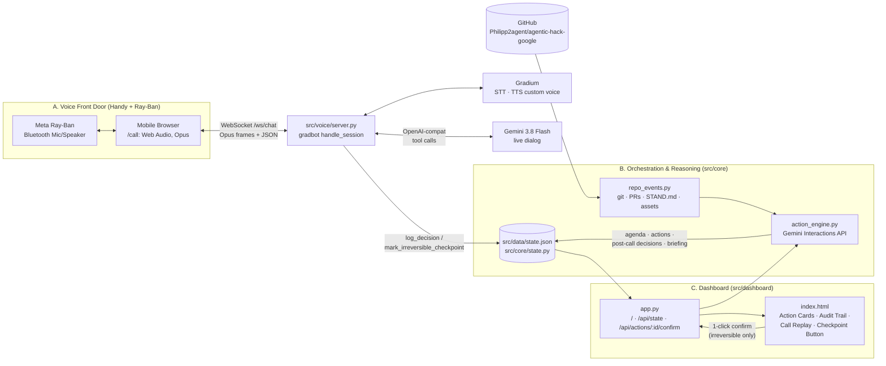

# DawnDispatch – Systemarchitektur (Auftrag claude-02)

Stand 10.10.2026, 16:20 CEST. Verbindlich fuer die Bau-Pakete `auftraege/gemini-01.md` bis `gemini-04.md` (Baufenster 16:15–18:00, Feature-Freeze 18:00, Abgabe 19:00).
Sprache: Doku Deutsch; Code, Prompts, UI und Commit-Texte Englisch.

## 0. Leitplanken (nicht verhandelbar)
- **Kein Twilio, kein WhatsApp.** Der Anruf ist eine mobile Web-Seite (`/call`) mit Web Audio + WebSocket; Audio laeuft per Bluetooth ueber die Meta-Ray-Ban-Brille (Mikro + Open-Ear-Lautsprecher). Mikrofonzugriff im Browser braucht HTTPS → oeffentlicher Zugang ueber den cloudflared-Tunnel am VPS.
- **Fundament:** gradbot-Demo `simple_chat` (`/home/buzzagent/hack/vendor/gradbot/demos/simple_chat`): FastAPI + `gradbot.websocket.handle_session` + Gradium STT/TTS. Wir kopieren das Muster, nicht die Dateien.
- **Stack:** Gemini 3.8 Flash (a) ueber OpenAI-kompatiblen Endpunkt in der gradbot-Sprachschleife (`LLM_BASE_URL`/`LLM_MODEL`), (b) ueber `google-genai` Interactions API fuer Agenda-Synthese und Post-Call-Extraktion. Gradium STT/TTS + Voice Design ueber gradbot. FastAPI + HTML/Tailwind (CDN) + Vanilla JS.
- **Ein Prozess:** `uvicorn src.app:app` serviert Voice-WebSocket und Dashboard. Zustand = eine JSON-Datei (`src/data/state.json`, git-ignoriert) hinter `src/core/state.py`.
- **Human Checkpoint:** Alles Unumkehrbare (`DELETE_FILES`, `TAG_RELEASE`, `PUBLISH_ASSET`) wird per Stimme nur *beschlossen*, nie ausgefuehrt. Ausfuehrung erst nach Klick im Laptop-Dashboard.
- **Keine Schluessel im Repo.** Nur `.env.example` ohne Werte; am VPS `set -a; . /home/buzzagent/hack/secrets.env; set +a`.

## 1. Systemuebersicht



ASCII-Variante (fuer Terminals):

```
 Ray-Ban ⇄ Handy-Browser /call ══ WS /ws/chat ══ src/voice/server.py ⇄ Gradium STT/TTS
                                                     │  tools: log_decision, mark_irreversible_checkpoint
                                                     ▼
 GitHub repo ─► src/core/repo_events.py ─► src/core/action_engine.py (Gemini 3.8 Flash, Interactions API)
                                                     │  agenda · actions · post-call · briefing
                                                     ▼
                                           src/data/state.json  (src/core/state.py)
                                                     │  GET /api/state (poll 2 s)
                                                     ▼
 Laptop-Browser /  ◄── src/dashboard/app.py ──► POST /api/actions/{id}/confirm ──► execute_action()
```

**Ablauf (Demo-Skript aus IDEE.md → Komponenten):**
1. *Vorher (hack-chef, einmalig):* `python -m src.core.action_engine --seed` sammelt Repo-Events, synthetisiert eine 3-Punkte-Agenda (Gemini) und schreibt `state.json`.
2. *0:00 Anruf:* Handy oeffnet `/call`, tippt Start → WS `start` → gradbot spricht zuerst (`assistant_speaks_first`), Begruessung + Agenda-Punkt 1.
3. *0:25 Entscheidungen:* Philipp antwortet → STT → Gemini ruft `log_decision` → `state.add_decision` → `action_engine.on_decision` fuehrt Reversibles sofort aus, Unumkehrbares wird `BLOCKED_ON_CHECKPOINT`; Agent sagt das an und ruft `mark_irreversible_checkpoint`.
4. *0:55 Laptop:* Dashboard pollt `/api/state`, zeigt Call-Replay, Action Cards mit Artefakten, Checkpoint-Button; Klick → `confirm_checkpoint` → `execute_action` → Artefakt (Diff/Commit) erscheint. Briefing (3 Bullets) aus `process_post_call`.

## 2. Datenmodelle & Schnittstellen (eingefroren)

Quelle der Wahrheit: **`src/core/models.py`** (Pydantic v2, liegt bereits auf `main`). Regel: Felder ergaenzen ja, umbenennen/loeschen nein. Nur hack-bau1 editiert die Datei; hack-bau2/3 importieren.

| Modell | Pflichtfelder | Optionale Felder (Default) | Vokabular |
|---|---|---|---|
| `OvernightEvent` | `id`, `source`, `agent_id`, `title` | `details`, `severity`=`info`, `proposed_action`, `timestamp`, `ref` | `source`: git_commit, pull_request, agent_log, board, asset, manual · `severity`: info, low, medium, high, critical |
| `AgendaItem` | `item_id`, `topic`, `question_for_lead`, `recommended_action` | `is_irreversible`=false, `action_type`=`NOTE`, `event_ids`, `priority`=1 | `action_type` s. u. |
| `DecisionRecord` | `item_id`, `decision_type` | `decision_id`(auto), `voice_notes`, `timestamp`(auto), `human_verified`=false, `source`=`voice_tool` | `decision_type`: APPROVE, REJECT, HOLD, AMEND · `source`: voice_tool, post_call, dashboard |
| `ActionExecution` | `item_id`, `action_type` | `action_id`(auto), `status`=`PENDING`, `description`, `artifacts[]`, `checkpoint_reason`, `created_at`, `updated_at` | `status`: PENDING, EXECUTING, COMPLETED, BLOCKED_ON_CHECKPOINT, FAILED |
| `Artifact` | `label` | `kind`=`text`, `content`, `url` | `kind`: diff, commit, link, log, file, text |
| `TranscriptTurn` | `role`, `text` | `t_s`, `turn_idx` | `role`: agent, user, tool |
| `CallRecord` | – | `status`=`idle`, `started_at`, `ended_at`, `language`=`en`, `voice_id`, `transcript[]`, `audio_url`, `briefing[]` | `status`: idle, live, ended |
| `DawnState` | – | `version`, `generated_at`, `events[]`, `agenda[]`, `decisions[]`, `actions[]`, `call`, `meta{}` | Gesamtzustand = `state.json` |

`action_type`-Vokabular (`models.ACTION_TYPES`): reversibel `MERGE_BRANCH`, `DISPATCH_AGENT`, `RUN_TESTS`, `UPDATE_BUDGET`, `NOTE`; **unumkehrbar** `DELETE_FILES`, `TAG_RELEASE`, `PUBLISH_ASSET` (`models.IRREVERSIBLE_ACTION_TYPES`). Regel: `AgendaItem.is_irreversible == (action_type in IRREVERSIBLE_ACTION_TYPES)`.

Zeitstempel: ISO 8601 UTC, Sekunden (`models.now_iso()`). IDs: `ev-0001`, `ag-01`, `dec-<8hex>`, `act-<8hex>`.

**Beispiel (gekuerzt, vollstaendig in `src/data/state.example.json`):**
```json
{"agenda":[{"item_id":"ag-02","topic":"Title image drafts",
  "question_for_lead":"hack-visual delivered three title images. Keep v3 and delete v1 and v2 from the repo?",
  "recommended_action":"Keep assets/titelbild-v3.jpg; delete assets/titelbild.jpg and assets/titelbild-v2.jpg",
  "is_irreversible":true,"action_type":"DELETE_FILES","event_ids":["ev-0001"],"priority":2}],
 "decisions":[{"decision_id":"dec-1a2b3c4d","item_id":"ag-02","decision_type":"APPROVE",
  "voice_notes":"keep v3, drop the drafts","timestamp":"2026-10-10T15:02:11+00:00","human_verified":false,"source":"voice_tool"}],
 "actions":[{"action_id":"act-9f8e7d6c","item_id":"ag-02","action_type":"DELETE_FILES","status":"BLOCKED_ON_CHECKPOINT",
  "description":"git rm assets/titelbild.jpg assets/titelbild-v2.jpg","artifacts":[],
  "checkpoint_reason":"Deleting files from the public repo is irreversible","created_at":"...","updated_at":"..."}],
 "call":{"status":"ended","transcript":[{"role":"agent","text":"Good morning Philipp. ...","t_s":0.4,"turn_idx":0}],
  "briefing":["Architecture merged, four builders dispatched","Title image v3 chosen; draft deletion awaits your click","Image budget set to 40 finals"]}}
```

**State-Store `src/core/state.py` (liegt auf `main`):** `load()`, `save()`, `reset()`, `update(fn)`, `add_decision()`, `latest_decision()`, `add_action()`, `set_action_status()`, `confirm_checkpoint()`, `start_call()`, `append_turn()`, `end_call()`. Thread-sicher (RLock), atomares Schreiben. CLI `python -m src.core.state --reset|--show|--json`. Niemand schreibt `state.json` direkt.

**Integrationsnaehte (Funktionen, die hack-bau1 in `src/core/action_engine.py` bereitstellt und die bau2/bau3 per `try: import` aufrufen):**

```python
def synthesize_agenda(events: list[OvernightEvent], refresh: bool = False) -> list[AgendaItem]: ...
def on_decision(record: DecisionRecord) -> list[ActionExecution]:
    """plan + execute reversible actions now; create BLOCKED_ON_CHECKPOINT for irreversible ones"""
def execute_action(action_id: str) -> ActionExecution:
    """EXECUTING -> COMPLETED|FAILED, attaches artifacts (diff, commit, log)"""
def process_post_call() -> CallRecord:
    """extract decisions missing from the transcript (source=post_call), build 3-bullet briefing; idempotent"""
```
Aufrufmuster in bau2/bau3 (bis zum Merge von gemini-01 laeuft der Code ohne Engine weiter):
```python
try:
    from src.core import action_engine
except ImportError:  # gemini-01 not merged yet
    action_engine = None
...
if action_engine: await asyncio.to_thread(action_engine.on_decision, record)
```

## 3. Voice Dialog & Tool-Calling

**Session-Konfiguration (gradbot):** `gradbot.SessionConfig(voice_id=DAWN_VOICE_ID or catalog default, language=gradbot.LANGUAGES[lang], instructions=build_instructions(agenda, lead, lang), assistant_speaks_first=True, silence_timeout_s=6.0, tools=[...], **cfg.session_kwargs)`. LLM = `LLM_MODEL` (gemini-3.8-flash) ueber `LLM_BASE_URL` (OpenAI-kompatibel), konfiguriert via `gradbot.config.from_env()`.

**Prompt-Design (`src/voice/prompt.py::build_instructions`)**, Englisch, agenda-getrieben, Ziel ≤ 90 s:
```
You are Dawn, the morning dispatcher for {lead}'s engineering team. {lead} is walking to the office
and hears you through smart glasses; they cannot see a screen. Be brief, warm, decisive.
AGENDA (ask in this order, one item at a time):
1. [ag-01] {topic} — {question_for_lead} (recommended: {recommended_action})
2. [ag-02] {topic} — ... (IRREVERSIBLE: needs laptop confirmation)
3. ...
RULES
- Open with: "Good morning {lead}. Overnight triage in agentic-hack-google is done. {n} items need your decision before standup." Then ask item 1.
- Max 2 sentences per turn. Never list more than one item at a time. No markdown, no code.
- As soon as {lead} answers an item, call log_decision(item_id, decision, notes) BEFORE you speak again. Map words:
  approve/yes/go/ship -> APPROVE; no/reject/drop -> REJECT; later/wait/park -> HOLD; "but"/changes -> AMEND (put the change in notes).
- For an IRREVERSIBLE item: after log_decision also call mark_irreversible_checkpoint(item_id, reason) and say:
  "Recorded. That one is irreversible, so it waits for your click on the laptop." Never claim it was executed.
- If an answer is unclear, ask once; if still unclear, log HOLD and move on.
- After the last item say: "All decisions processed. See you at your desk." and stop talking.
- Speak {language_name}. Keep the whole call under 90 seconds.
```

**Gemini Tools (gradbot `ToolDef`, Parameter als JSON Schema):**
```python
TOOLS = [
  gradbot.ToolDef(name="log_decision",
    description="Record the lead's decision for one agenda item. Call immediately after the lead answers.",
    parameters_json=json.dumps({"type":"object","properties":{
      "item_id":{"type":"string","description":"agenda item id, e.g. ag-01"},
      "decision":{"type":"string","enum":["APPROVE","REJECT","HOLD","AMEND"]},
      "notes":{"type":"string","description":"the lead's words, amendments or conditions"}},
      "required":["item_id","decision"]})),
  gradbot.ToolDef(name="mark_irreversible_checkpoint",
    description="Flag that an approved item is irreversible and must be confirmed by a click on the laptop dashboard before execution.",
    parameters_json=json.dumps({"type":"object","properties":{
      "item_id":{"type":"string"},"reason":{"type":"string"}},"required":["item_id","reason"]})),
]
```
Tool-Ergebnisse (kurz halten, Gemini 3.x ueber OpenAI-compat mag keine mehrstufigen Tool-Ketten, s. Risiken): `log_decision` → `{"ok":true,"item_id":"ag-01","recorded":"APPROVE","next_item_id":"ag-02"|null}`; `mark_irreversible_checkpoint` → `{"ok":true,"checkpoint":"BLOCKED_ON_CHECKPOINT"}`.

**Server-Verhalten je Tool (`src/voice/server.py::on_tool_call`):**
1. `log_decision`: item_id gegen Agenda pruefen (sonst `send_error`), `DecisionRecord(source="voice_tool")` → `state.add_decision` → Naht `action_engine.on_decision` (falls importierbar) → `handle.send_json(result)` → Client-Event `{"type":"decision_logged","item_id":..,"decision":..}`.
2. `mark_irreversible_checkpoint`: `state.update` setzt `meta["checkpoint_reason:"+item_id]=reason` und, falls Action existiert, `checkpoint_reason` → Client-Event `{"type":"checkpoint_marked","item_id":..}`.
3. Transkript: `handle_session` schreibt `user_text`/`agent_text` direkt ans WebSocket. Persistenz ueber einen **Proxy** um das `WebSocket`-Objekt (`__getattr__` delegiert; `send_json` faengt `user_text`/`agent_text` ab → `state.append_turn(TranscriptTurn(role, text, t_s=stop_s, turn_idx))`, dann weiterreichen).
4. Session-Ende (nach `handle_session`): `state.end_call()` → Naht `action_engine.process_post_call()` in `asyncio.to_thread`.

**Gemini Interactions API (src/core, hack-bau1)** – `google-genai >= 2.3.0`, `client = genai.Client()` (liest `GEMINI_API_KEY`):
```python
AGENDA_SCHEMA = {"type":"object","properties":{"items":{"type":"array","maxItems":3,"items":{"type":"object",
  "properties":{"item_id":{"type":"string"},"topic":{"type":"string"},"question_for_lead":{"type":"string"},
  "recommended_action":{"type":"string"},"is_irreversible":{"type":"boolean"},
  "action_type":{"type":"string","enum":list(ACTION_TYPES)},"event_ids":{"type":"array","items":{"type":"string"}},
  "priority":{"type":"integer"}},"required":["item_id","topic","question_for_lead","recommended_action","is_irreversible","action_type"]}}},
  "required":["items"]}
ix = client.interactions.create(model="gemini-3.8-flash", system_instruction=AGENDA_PROMPT,
        input=json.dumps([e.model_dump() for e in events]),
        response_format={"type":"text","mime_type":"application/json","schema":AGENDA_SCHEMA},
        response_mime_type="application/json")
items = [AgendaItem(**x) for x in json.loads(ix.output_text)["items"]]
state.update(lambda s: s.meta.__setitem__("agenda_interaction_id", ix.id))
# post-call: same client, chained on the agenda interaction (server-side state):
ix2 = client.interactions.create(model="gemini-3.8-flash", previous_interaction_id=ix.id,
        input=json.dumps({"transcript": [...], "decided_item_ids": [...]}),
        response_format={"type":"text","mime_type":"application/json","schema":POSTCALL_SCHEMA}, response_mime_type="application/json")
# function calling shape (if the engine needs it): step.type == "function_call" -> step.name/step.arguments/step.id,
# reply with input=[{"type":"function_result","name":step.name,"call_id":step.id,"result":...}]
```
Fallback, falls `interactions` am Workshop-Key fehlschlaegt: `client.models.generate_content(model=..., contents=..., config={"response_mime_type":"application/json","response_schema":SCHEMA})` hinter derselben Funktion `_gemini_json(system, user, schema) -> dict`. Zweiter Fallback: gecachte `src/data/agenda.json`.

## 4. Verzeichnis- & Dateistruktur (Ownership)

```
agentic-hack-google/
├── .env.example                 # claude-02   Variablen ohne Werte
├── requirements.txt             # claude-02
├── src/
│   ├── app.py                   # claude-02   kombinierter Einstieg: uvicorn src.app:app (mountet alles, was gemerged ist)
│   ├── core/                    # hack-bau1  (gemini-01)
│   │   ├── models.py            #   claude-02 eingefroren; bau1 darf erweitern
│   │   ├── state.py             #   claude-02 eingefroren; bau1 darf erweitern
│   │   ├── repo_events.py       #   bau1: Aggregator git/PR/STAND.md/assets -> OvernightEvent
│   │   ├── gemini_client.py     #   bau1: Interactions-API-Wrapper + generate_content-Fallback
│   │   └── action_engine.py     #   bau1: synthesize_agenda / on_decision / execute_action / process_post_call + CLI
│   ├── voice/                   # hack-bau2  (gemini-02)
│   │   ├── server.py            #   router: /ws/chat, /ws/tts, /api/voices, /api/audio-config; standalone app
│   │   ├── prompt.py            #   build_instructions(agenda, lead, lang), TOOLS
│   │   ├── voice_design.py      #   Gradium Voice Design -> DAWN_VOICE_ID (CLI)
│   │   ├── simulate_call.py     #   Simulation ohne Mikro (+ --live Smoke gegen /ws/chat)
│   │   └── static/index.html    #   Dev-Testseite (Kopie simple_chat, nur fuer bau2-Tests)
│   ├── dashboard/               # hack-bau3  (gemini-03)
│   │   ├── app.py               #   router: /, /call, /api/state, /api/actions/{id}/confirm, /api/state/reset; standalone app
│   │   ├── templates/index.html #   Laptop-Dashboard (Tailwind CDN, pollt /api/state)
│   │   ├── templates/call.html  #   Mobile Start-Seite fuer den Voice-Call (Ray-Ban)
│   │   └── static/              #   dashboard.js, call.js, css, eigene Icons
│   └── data/                    # hack-bau1 schreibt Seeds; alle lesen
│       ├── state.example.json   #   claude-02 Fixture (UI-/Voice-Tests ohne Engine)
│       ├── overnight_events.json#   bau1: echte Repo-Events (committet)
│       ├── agenda.json          #   bau1: letzte Gemini-Synthese (committet, Cache/Fallback)
│       ├── state.json           #   Laufzeit, git-ignoriert (python -m src.core.state --reset)
│       └── audio/               #   Laufzeit, git-ignoriert
├── tests/
│   ├── test_contract.py         # claude-02
│   ├── test_core.py             # bau1
│   ├── test_voice.py            # bau2
│   └── test_dashboard.py        # bau3
├── assets/                      # hack-visual (gemini-04): hero_banner.jpg, system_flow.jpg, app_icon.png
├── docs/VISUALS.md              # hack-visual
└── tools/bild.py                # hack-visual darf erweitern (--format), sonst niemand
```
Ersetzt den Vorschlag `src/api, src/ui` aus `docs/STRUKTUR.md`. `STAND.md`, `README.md`, `AGENTEN.md` gehoeren hack-chef.

## 5. HTTP/WebSocket-Schnittstellen

| Pfad | Methode | Owner | Zweck |
|---|---|---|---|
| `/api/health` | GET | claude-02 | `{"status":"ok"}` |
| `/ws/chat` | WS | bau2 | Voice-Session (Protokoll unten) |
| `/ws/tts` | WS | bau2 | One-Shot-TTS: `{"type":"speak","text":..}` → Audio-Bytes + `{"type":"done"}` (Dashboard-Replay) |
| `/api/voices` | GET | bau2 | Gradium-Katalog (wie gradbot `routes.setup(with_voices=True)`) |
| `/api/audio-config` | GET | bau2 | `{"pcm": false}` |
| `/` | GET | bau3 | Dashboard (`templates/index.html`) |
| `/call` | GET | bau3 | Mobile Call-Seite (`templates/call.html`), `?lang=en|de` |
| `/api/state` | GET | bau3 | `DawnState` als JSON (Dashboard pollt alle 2 s) |
| `/api/actions/{action_id}/confirm` | POST | bau3 | `state.confirm_checkpoint` → `action_engine.execute_action` → `{"action": ...}` |
| `/api/state/reset` | POST | bau3 | Dev/Demo: `state.reset()` |
| `/static/js/*` | GET | claude-02 (app.py) | gradbot-Audio-JS (`opus-encoder.js`, `audio-processor.js`, `synced-audio-player.js`, Worker) |
| `/static/*`, `/assets/*`, `/data/audio/*` | GET | claude-02 (app.py) | Dashboard-Statics, Bilder, Aufnahmen |

**WS `/ws/chat` Protokoll (gradbot, unveraendert + App-Events):**
- Client → Server: `{"type":"start","voice_id":"<optional>","language":"en|de","lead":"Philipp"}`; danach binaere Opus-Frames (`SyncedAudioPlayer.onEncodedAudio`); `{"type":"stop"}`.
- Server → Client (gradbot): `{"type":"user_text","text","stop_s","turn_idx"}`, `{"type":"agent_text",...}`, `{"type":"audio_timing","start_s","stop_s","turn_idx","interrupted"}` gefolgt von Audio-Bytes (Opus), `{"type":"event","event":"..."}`, `{"type":"error","message"}`.
- Server → Client (DawnDispatch-Events, von bau2 gesendet, von bau3 gerendert): `{"type":"agenda","items":[AgendaItem...]}` direkt nach `start`; `{"type":"decision_logged","item_id","decision"}`; `{"type":"checkpoint_marked","item_id"}`; `{"type":"call_ended"}`.
- Client-JS: `new SyncedAudioPlayer({basePath:'/static/js', sampleRate:24000, pcmOutput:false, onEncodedAudio, onText, onEvent})`, `ws.onmessage = e => player.handleMessage(e.data)`; unbekannte JSON-Typen landen in `onEvent(type, msg)`.

## 6. Laufzeit, Betrieb, Tests
- Python: `/home/buzzagent/hack/.venv/bin/python` (gradbot, google-genai, fastapi, uvicorn, pydantic, httpx). Arbeitsverzeichnis = Repo-Wurzel, Imports als `src.*`.
- Schluessel: `set -a; . /home/buzzagent/hack/secrets.env; set +a` (`GRADIUM_API_KEY`, `GEMINI_API_KEY`, `LLM_API_KEY`, `LLM_BASE_URL`, `LLM_MODEL`). Optional `DAWN_VOICE_ID`, `DAWN_LANGUAGE`, `DAWN_STATE_PATH`.
- Start: `python -m src.core.state --reset && uvicorn src.app:app --host 0.0.0.0 --port 8000`; oeffentlich per `cloudflared tunnel --url http://localhost:8000` (HTTPS noetig fuer Mikro am Handy).
- Tests ohne Drittpakete: `python -m unittest tests.test_contract tests.test_core tests.test_voice tests.test_dashboard -v` (FastAPI `TestClient` nutzt httpx, vorhanden). Alle Tests muessen **ohne** Netz und ohne Schluessel laufen (Gemini/Gradium nur hinter Flags wie `--live`).
- Merge-Reihenfolge durch hack-chef: gemini-01 → gemini-02 → gemini-03 → gemini-04 (Assets jederzeit). Jede Reihenfolge funktioniert, weil `src/app.py` fehlende Module ueberspringt.

## 7. Risiken & Fallbacks
| Risiko | Massnahme |
|---|---|
| Gemini 3.x ueber OpenAI-compat: HTTP 400 `missing thought_signature` bei mehrstufigen Tool-Ketten (docs/SETUP.md) | Pro Turn genau ein Tool-Call, kurze Tool-Ergebnisse, kein Tool nach Tool. Env-Schalter `LLM_MODEL=gemini-2.5-flash` nur fuer die Sprachschleife, falls 400 auftritt. |
| Interactions API am Workshop-Key nicht freigeschaltet / anderes SDK-Feld (`schema` vs `schema_`) | `_gemini_json` mit Fallback auf `generate_content` + `response_schema`; dritter Fallback gecachte `agenda.json`. |
| Mikro im mobilen Browser blockiert (kein HTTPS, iOS Autoplay) | cloudflared-HTTPS; Start nur per Tap; `AudioContext` erst im Tap-Handler erzeugen (gradbot-JS tut das in `player.start()`). |
| Bluetooth-Brille liefert nur 16 kHz Headset-Profil | STT ist robust; Echo-Cancellation im Player anlassen; Fallback Handy-Lautsprecher/Kopfhoerer. |
| Call-Audio-Mitschnitt fehlt fuer Replay | Replay = synchronisiertes Transkript + Wellenform-Animation + Agent-Zeilen ueber `/ws/tts` neu gesprochen. Original-Mitschnitt (MediaRecorder am Handy → `/data/audio/`) ist Stretch-Ziel. |
| Zwei Agenten aendern dieselbe Datei | Ownership-Tabelle in Abschnitt 4; `models.py`/`state.py` nur bau1; Nahtstellen per `try: import`. |
| Quota (gemini-3.8-flash 1K RPM/10K RPD, Nano Banana Pro 250/Tag) | Keine Schleifentests gegen Gemini; Live-Tests nur hinter `--live`; hack-visual max. 10 Finale. |
