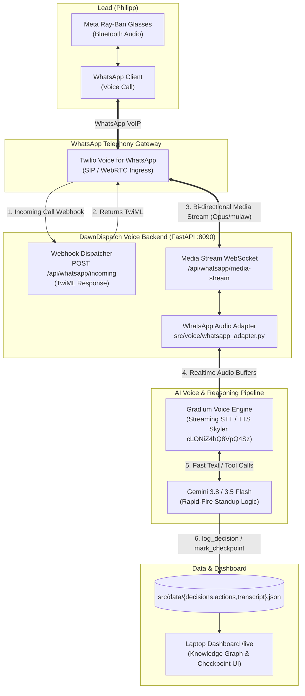

# DawnDispatch – WhatsApp Voice Telephony Architecture & Integration

**Status:** Freigegeben für die Nachtschicht (Auftrag NACHT-A / Freigabe im Live-Call durch Philipp)  
**Ziel:** Vollständige Konfiguration, Architektur und Adapter-Schnittstelle für echte WhatsApp-Telefonie via Gradium STT/TTS und Twilio Media Streams.

---

## 1. Übersicht & Zielsetzung

In Version 1 simulierte DawnDispatch den Anruf über eine responsive Web-Audio-Oberfläche (`/call`), gekoppelt per Bluetooth an die Meta Ray-Ban Brille. Im Live-Call hat Philipp die direkte WhatsApp-Telefonie für Version 2 freigegeben (*"I want the real WhatsApp calls"*).

### Kernanforderungen
1. **Direkte WhatsApp-Telefonie:** Eingehende Anrufe von Philipp oder autonome ausgehende Anrufe von Dawn direkt über WhatsApp Voice.
2. **Hands-Free Commute:** Nahtlose Audio-Verbindung über WhatsApp Audio auf Philipps Meta Ray-Ban Brille beim Gang ins Büro.
3. **Ultra-Low-Latency Audio Pipeline:** Bi-direktionales Streaming (Twilio Media Streams ⇄ Gradium STT/TTS ⇄ Gemini 3.8/3.5 Flash).
4. **Human Checkpoint Invariante:** Unumkehrbare Entscheidungen (`is_irreversible = true`) werden per Stimme beschlossen, aber erst nach 1-Klick-Freigabe im Laptop-Dashboard ausgeführt.

---

## 2. Systemarchitektur & Datenfluss

DawnDispatch nutzt eine Event- & Stream-Architektur. Twilio dient als WhatsApp Voice Gateway, empfängt Anrufe und streamt Roh-Audio via WebSockets direkt an den DawnDispatch WhatsApp Audio Adapter, der die Brücke zu Gradium und Gemini bildet.

### 2.1 Architektur-Diagramm



### 2.2 Terminal / ASCII-Übersicht

```
[Philipp + Ray-Ban] 
       │ (WhatsApp Voice Call)
       ▼
[Twilio WhatsApp Gateway]
       │ 
       ├─► HTTP POST /api/whatsapp/incoming ──► Returns TwiML <Connect><Stream url="wss://..."/>
       │
       ▼ (Bi-directional WebSocket Audio Stream)
[DawnDispatch: src/voice/whatsapp_adapter.py]
       │
       ├──► Gradium STT/TTS (WebSocket, 24kHz / mu-law Bridge)
       ├──► Gemini 3.8 Flash (Rapid-Fire Decision Logic)
       └──► src/data/ (decisions.json, actions.json, transcript.json)
              │
              ▼
[Laptop Dashboard: /live (Vorher/Nachher Graph + 1-Click Checkpoint)]
```

---

## 3. Signal- & Streaming-Protokoll

### 3.1 Inbound Call Ablauf (Philipp ruft an)

1. Philipp startet einen Sprachanruf auf WhatsApp an die hinterlegte DawnDispatch-Nummer.
2. Twilio sendet einen HTTP POST Webhook an `https://<public-url>/api/whatsapp/incoming` mit den Parametern:
   - `CallSid`: Eindeutige Anruf-ID
   - `From`: `whatsapp:+4179XXXXXXX` (Philipps verifizierte Nummer)
   - `To`: `whatsapp:+1415XXXXXXX` (DawnDispatch WhatsApp Service-Nummer)
3. DawnDispatch validiert den Anrufer und antwortet mit TwiML:
   ```xml
   <?xml version="1.0" encoding="UTF-8"?>
   <Response>
       <Connect>
           <Stream url="wss://<public-url>/api/whatsapp/media-stream">
               <Parameter name="caller" value="Philipp" />
               <Parameter name="channel" value="whatsapp_voice" />
           </Stream>
       </Connect>
   </Response>
   ```
4. Twilio initiiert sofort die WebSocket-Verbindung zu `/api/whatsapp/media-stream`.

### 3.2 Outbound Call Ablauf (Dawn ruft Philipp an)

1. Vorbereitete Agenda-Items oder Checkpoints triggern den Morgenanruf via CLI oder REST-Endpunkt:
   ```bash
   python -m src.voice.whatsapp_adapter --call
   ```
   oder `POST /api/whatsapp/call`.
2. DawnDispatch ruft die Twilio REST API auf (`https://api.twilio.com/2010-04-01/Accounts/{AccountSid}/Calls.json`):
   ```json
   {
     "To": "whatsapp:+41791234567",
     "From": "whatsapp:+14155238886",
     "Url": "https://<public-url>/api/whatsapp/incoming"
   }
   ```
3. Philipps Handy klingelt auf WhatsApp mit dem Display-Namen **"DawnDispatch"**.
4. Beim Abheben verbindet Twilio via TwiML-Stream direkt in die WebSocket-Voice-Schleife.

### 3.3 WebSocket Media Stream Protokoll

Twilio sendet JSON-Frames über den WebSocket:

1. **`connected` Event:**
   ```json
   {"event": "connected", "protocol": "Call", "version": "1.0.0"}
   ```
2. **`start` Event:**
   ```json
   {
     "event": "start",
     "streamSid": "MZ1234567890abcdef",
     "start": {
       "callSid": "CA1234567890abcdef",
       "mediaFormat": {"encoding": "audio/x-mulaw", "sampleRate": 8000, "channels": 1}
     }
   }
   ```
3. **`media` Event (Inbound Audio von Philipp):**
   ```json
   {
     "event": "media",
     "streamSid": "MZ1234567890abcdef",
     "media": {
       "payload": "<base64-encoded-mulaw-audio-chunk>",
       "timestamp": "1234"
     }
   }
   ```
4. **Outbound Audio (Dawns Stimme an Philipp):**
   DawnDispatch sendet synthetisiertes Audio von Gradium zurück an Twilio:
   ```json
   {
     "event": "media",
     "streamSid": "MZ1234567890abcdef",
     "media": {
       "payload": "<base64-encoded-mulaw-audio-chunk>"
     }
   }
   ```
5. **`stop` Event:**
   ```json
   {"event": "stop", "streamSid": "MZ1234567890abcdef"}
   ```

---

## 4. Umgebungsparameter (`.env`)

Für den Betrieb der echten WhatsApp-Telefonie werden folgende Umgebungsvariablen definiert:

| Variable | Pflicht | Typ | Standardwert | Beschreibung |
|---|---|---|---|---|
| `WHATSAPP_VOICE_ENABLED` | Nein | bool | `false` | Aktiviert die WhatsApp-Telefonie-Endpunkte und den Stream-Adapter. |
| `TWILIO_ACCOUNT_SID` | Ja* | string | - | Twilio Account SID aus der Twilio Console. |
| `TWILIO_AUTH_TOKEN` | Ja* | string | - | Twilio Auth Token zur Signaturvalidierung und API-Aufrufe. |
| `TWILIO_WHATSAPP_NUMBER` | Ja* | string | `whatsapp:+14155238886` | Von Twilio bereitgestellte WhatsApp Business Sender-Nummer. |
| `LEAD_WHATSAPP_NUMBER` | Ja* | string | `whatsapp:+41791234567` | Telefonnummer des Leads (Philipp), der angerufen wird. |
| `WHATSAPP_WEBHOOK_URL` | Ja* | string | - | Öffentliche URL für Twilio-Webhooks (z. B. Cloudflare Tunnel URL). |
| `WHATSAPP_WS_STREAM_URL` | Nein | string | - | WebSocket URL für Media Stream (Default: abgeleitet aus Webhook URL). |
| `GRADIUM_API_KEY` | Ja | string | - | Gradium API Key für Ultra-Low-Latency STT/TTS. |
| `DAWN_VOICE_ID` | Nein | string | `cLONiZ4hQ8VpQ4Sz` | Gradium Voice ID (Standard: Skyler, oder eigene geclonte Lead-Voice). |
| `LLM_MODEL` | Nein | string | `gemini-3.5-flash-lite` | Modell für Dialog und Tools in der Sprachschleife. |

*\* Nur für Live-Anrufe erforderlich; ohne Credentials schaltet der Adapter automatisch in den validierten Mock-/Dry-Run-Modus für Tests.*

### Beispiel `.env` Konfiguration
```bash
# WhatsApp Voice Telephony (Twilio Gateway)
WHATSAPP_VOICE_ENABLED=true
TWILIO_ACCOUNT_SID=ACXXXXXXXXXXXXXXXXXXXXXXXXXXXXXXXX
TWILIO_AUTH_TOKEN=your_twilio_auth_token_here
TWILIO_WHATSAPP_NUMBER=whatsapp:+14155238886
LEAD_WHATSAPP_NUMBER=whatsapp:+41791234567
WHATSAPP_WEBHOOK_URL=https://dawn.your-tunnel.trycloudflare.com/api/whatsapp/incoming

# Gradium Audio Engine & LLM
GRADIUM_API_KEY=your_gradium_api_key_here
DAWN_VOICE_ID=cLONiZ4hQ8VpQ4Sz
LLM_BASE_URL=https://generativelanguage.googleapis.com/v1beta/openai/
LLM_MODEL=gemini-3.5-flash-lite
```

---

## 5. Adapter-Implementierung (`src/voice/whatsapp_adapter.py`)

Der Adapter ist als modularer FastAPI `APIRouter` aufgebaut:
- **`POST /api/whatsapp/incoming`**: Liefert dynamisches TwiML mit `<Connect><Stream>` zurück. Unterstützt sowohl Form-Data (Twilio Standard) als auch JSON.
- **`POST /api/whatsapp/status`**: Empfängt Status-Callbacks (`initiated`, `ringing`, `in-progress`, `completed`).
- **`POST /api/whatsapp/call`**: Löst einen ausgehenden Anruf aus (via Twilio REST API oder Mock im Testbetrieb).
- **`GET /api/whatsapp/config`**: Liefert Konfigurationsstatus (ohne Schüssel zu leaken) für Monitoring.
- **`WebSocket /api/whatsapp/media-stream`**: Bidirektionaler Frame-Handler für Twilio Audio-Payloads.

---

## 6. Schritt-für-Schritt Setup-Anleitung

### Schritt 1: Twilio WhatsApp Voice freischalten
1. In der Twilio Console unter **Messaging > Try it out > Send a WhatsApp message** die Sandbox aktivieren (oder die WhatsApp Business Rufnummer verknüpfen).
2. WhatsApp Voice Feature in Twilio Console für die WhatsApp-Nummer aktivieren.

### Schritt 2: Public Ingress via Cloudflare Tunnel aufsetzen
Da WhatsApp/Twilio HTTPS- und WSS-Webhooks benötigt:
```bash
cloudflared tunnel --url http://localhost:8090
```
Die erzeugte URL (z. B. `https://xyz.trycloudflare.com`) als `WHATSAPP_WEBHOOK_URL` in `.env` hinterlegen.

### Schritt 3: Twilio Webhook konfigurieren
In der Twilio Rufnummernkonfiguration:
- **Voice Configuration:** "Webhook" auswählen
- **URL:** `https://xyz.trycloudflare.com/api/whatsapp/incoming`
- **HTTP Method:** `POST`

### Schritt 4: Testanruf ausführen
Mit laufendem Dawn Voice Server (`python -m src.voice.app` oder `./start.sh`):
```bash
# Dry-Run / Formatprüfung:
python -m src.voice.whatsapp_adapter --test-twiml

# Live-Anruf an Philipp triggern:
python -m src.voice.whatsapp_adapter --call
```

---

## 7. Verifikation & Qualitätssicherung

1. **Unit- & Integrationstests:**
   ```bash
   /home/buzzagent/hack/.venv/bin/pytest tests/test_whatsapp.py
   ```
2. **Volle Testsuite:**
   ```bash
   /home/buzzagent/hack/.venv/bin/pytest
   ```
   Alle Tests (Core, Dashboard, Voice, Bridge, Sample Project und WhatsApp Adapter) müssen grün bleiben.
